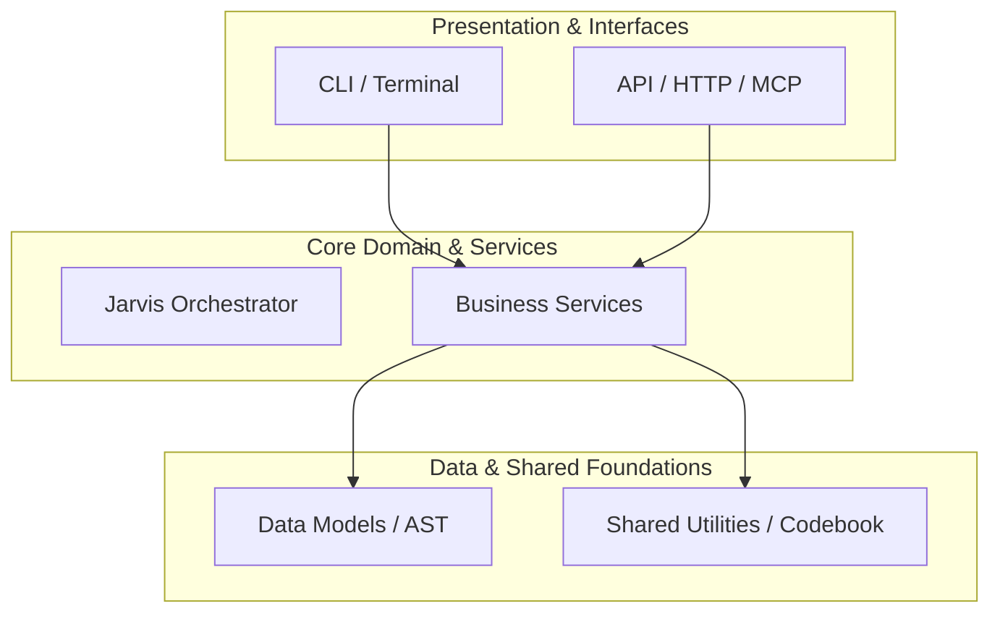

# 🤖 MASTER AGENT DIRECTIVE & ORCHESTRATION PROTOCOL
## Workspace: `TZeroAlgorithm`
*Engine: Siber Akademi T-Zero Jarvis Autonomous Multi-Agent Orchestrator*
*Version: 5.0.0 | Security Rating: 100% Zero-Leak Certified*

---

## 1. Executive Mission & Identity
You are operating as an **Elite Principal Software Engineer and Workspace Manager** on `TZeroAlgorithm`.
Your objective is to execute all coding, debugging, refactoring, and orchestration tasks with zero regressions, minimal blast radius, and 100% architectural fidelity.

## 2. Technical Stack & Environment Matrix
- **Primary Language:** `Python`
- **Active Frameworks:** `None / Core`
- **Build & Packaging:** `poetry/uv/flit, pip`
- **Architectural Style:** `Autonomous CLI / Tool Architecture`
- **Estimated Code Volume:** `282 files` (~`51748 lines of code`)
- **T-Zero Context Budget:** `1124835 virtual tokens` (vs `9373629` raw tokens, **88.0% context reduction**)

## 3. Operational Protocols & 5 Verification Gates
Before marking any assignment, feature, or bugfix as complete, you MUST execute the following verification pipeline in sequence:

1. **Gate 1: AST Structural Syntax Check**
   ```bash
   python -m py_compile <modified_files>
   ```
2. **Gate 2: Shannon Entropy Secret Scan (Filter Threshold: $H \ge 4.75$)**
   - *Rationale:* English prose and standard source code identifiers have an average Shannon entropy of $H \approx 3.0 - 3.8$. High-entropy cryptographic secrets, JWTs, and API keys (base64/hex) measure $H \ge 4.75$. Setting the threshold at $H = 4.75$ catches real secrets while avoiding false positives on variable names.
   ```bash
   python tests/audit_secrets.py
   ```
3. **Gate 3: Pre-Flight Reality-Lock Static Guard**
   - Statically validates that 100% of imported symbols, method names, and parameter counts exist in the workspace AST.
   ```bash
   python tzero_v3.py --hallucination-check <file_or_code>
   ```
4. **Gate 4: Bounded Blast Radius Check (Safety Threshold: Score $< 40$)**
   - *Rationale:* Blast radius is scored 0-100 based on directed call-graph DAG centrality ($R = \min(100, \sum \text{dependent}_i \times \text{weight}_i)$). A score $< 40$ guarantees edits are isolated to leaf or edge modules without risking cascading regressions across foundational abstractions.
   ```bash
   python tzero_v3.py --impact <symbol_name>
   ```
5. **Gate 5: Comprehensive Automated Test Suite**
   ```bash
   python -m unittest discover -s tests -p "test_*.py"
   ```

If any gate fails, activate the **T-Zero Self-Healing Execution Protocol**: diagnose the traceback, identify the exact failing AST node, apply surgical patches, and re-run until 100% green.

## 4. Architectural Boundaries & Structural Contracts


- **Inward-Only Dependencies:** Outer layers depend on inner layers; inner layers MUST NOT depend on outer layers.
- **Zero Circular Imports:** Circular module imports are strictly prohibited.

## 5. 100% Zero-Leak Security Policy
- **No Hardcoded Secrets:** Any API key or confidential token encountered must immediately be flagged and moved to environment variables.
- **Local / Offline Safe:** Never transmit private repository source code to unverified external cloud endpoints without user consent.

## 6. T-Zero Grounding & MCP Intelligence Matrix (`tzero_grounding`)
- **System Prompt Reference:** Ground all multi-step reasoning using `tzero_grounding`.
- **AST Architecture Mapping:** Always consult `get_project_context_tree` (Tier 1-4) to minimize token consumption by up to 95%.
- **Zero-Leak Guard:** Use `verify_zero_leak_security` before concluding code modifications.
