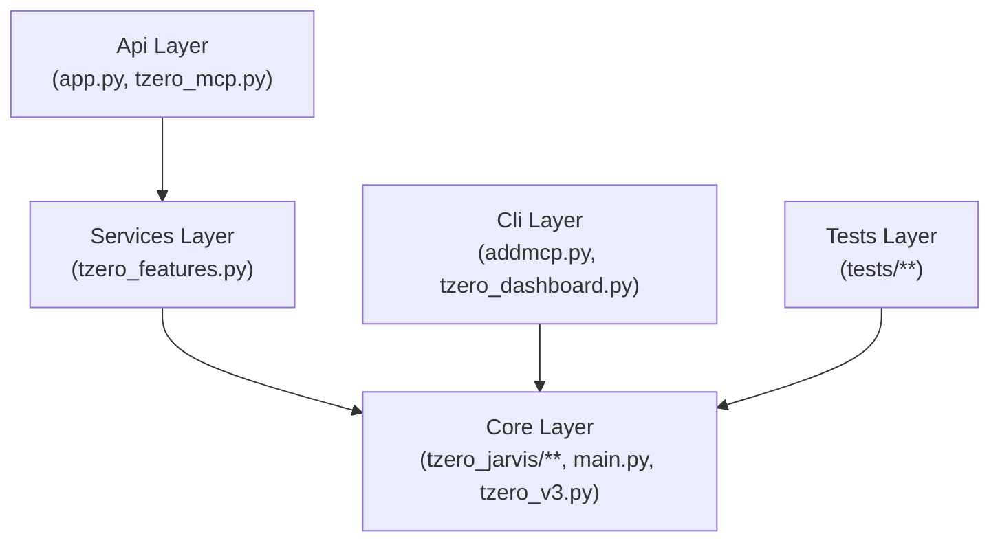

# 🏛️ SYSTEM ARCHITECTURE SPECIFICATION: TZeroAlgorithm
*Generated by Siber Akademi T-Zero Jarvis Autonomous Engine V5.0*

## 1. Architectural Blueprint
- **Project Name:** `TZeroAlgorithm`
- **Primary Paradigm:** `Autonomous CLI / Tool Architecture`
- **Primary Language:** `Python`
- **Active Frameworks:** `Standard Library`
- **Total Codebase Volume:** `447 files` (~`29336 lines`)

## 2. Component Topology & Dependency Flow

## 3. Layer Breakdown & Boundaries
| Layer | Scope / Patterns | Responsibility |
| :--- | :--- | :--- |
| **Tests** | `tests/**` | Managed layer for tests logic |
| **Core** | `tzero_jarvis/**, main.py, tzero_v3.py` | Managed layer for core logic |
| **Cli** | `addmcp.py, tzero_dashboard.py` | Managed layer for cli logic |
| **Api** | `app.py, tzero_mcp.py` | Managed layer for api logic |
| **Services** | `tzero_features.py` | Managed layer for services logic |

## 4. Invariant Rules & Security Gate
- **100% Zero-Leak:** Zero secrets committed to VCS.
- **AST Fidelity:** All public functions maintain docstrings and typed contracts.
- **Verification Command:** `python -m unittest discover -s tests -p "test_*.py"`
