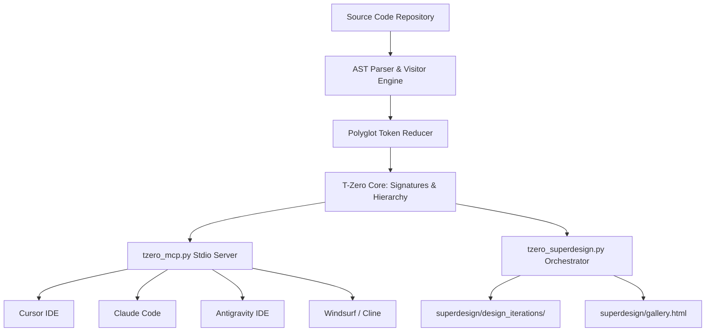

<a id="top"></a>
<div align="center">

# T-Zero Context Architect &bull; v7.2.0

**Enterprise Codebase Context Engine &amp; 47-Tool Autonomous MCP Server**

Cuts LLM context ingestion overhead by up to **94.9%** across 10+ programming languages while preserving complete type signatures, symbol hierarchy, and cross-file dependencies.

[](https://pypi.org/project/tzero-mcp/)
[](https://glama.ai/mcp/servers/toprakahmetaydogmus/TZeroAlgorithm)
[](https://github.com/toprakahmetaydogmus/TZeroAlgorithm/actions)
[](https://github.com/toprakahmetaydogmus/TZeroAlgorithm#security-architecture)
[](LICENSE)

[Quickstart](#quickstart) &bull; [Superdesign MCP](#superdesign-mcp-orchestrator) &bull; [MCP Tools](#mcp-tools-reference-47-tools) &bull; [Benchmarks](#reproducible-benchmarks) &bull; [Architecture](#system-architecture) &bull; [Türkçe Dokümantasyon](#turkce)

</div>

---

## Overview

Modern AI coding agents (Cursor, Claude Code, Antigravity IDE, Windsurf, Cline) suffer from severe context bloat when reading entire codebases, leading to high token costs, lost instructions, and hallucinations.

**T-Zero** solves this by acting as an intelligent context layer:
- **AST Signature Pruning**: Strips internal routine function and method implementation bodies while preserving every class definition, typed signature, docstring, and return type.
- **Polyglot Parsing**: Zero-dependency offline support for Python, TypeScript, JavaScript, Go, Rust, Java, C#, C++, PHP, and Ruby.
- **Native Superdesign Orchestrator**: Brings the open-source [Superdesign](https://github.com/superdesigndev/superdesign) AI design methodology to Claude Code and Cursor with 5 native tools and interactive HTML galleries.
- **Zero-Leak Security**: Guaranteed 100% offline execution with zero hardcoded API keys, telemetry, or remote relay servers.

---

## Quickstart

### 1. Instant Run via uvx (Zero Installation)

```bash
uvx tzero-mcp
```

### 2. Install via pip / pipx

```bash
pip install tzero-mcp
```

### 3. Connect to Your IDE (Cursor / Claude Desktop / Antigravity / Windsurf)

Add the following to your `mcp-settings.json` or IDE MCP configuration:

```json
{
  "mcpServers": {
    "tzero": {
      "command": "tzero-mcp"
    }
  }
}
```

### 4. Claude Code CLI Integration

```bash
claude mcp add --scope user tzero uvx tzero-mcp
```

### 5. Launch the Local Web Console

```bash
tzero --dashboard
```
Opens the modern slate control console on `http://localhost:8421` featuring the live AST reducer sandbox, 4D Causal-Temporal Graph, and Superdesign Canvas.

---

## Reproducible Benchmarks

| Analysis Target | Raw Context Volume | T-Zero Pruned Payload | Token Reduction | Query Cost Delta |
|:---|:---|:---|:---:|:---:|
| **Full Repository Scan** | `166,996 tokens` | `8,465 tokens` | **-94.9%** | **-$0.3963 / query** |
| **Large Backend Module** | `42,180 tokens` | `2,410 tokens` | **-94.3%** | **-$0.0994 / query** |
| **Micro-Patch Diff Stream** | `18,450 tokens` | `1,120 tokens` | **-93.9%** | **-$0.0433 / query** |

> Verify locally offline ($0 cost): `python tzero.py --savings`

---

## Superdesign MCP Orchestrator

T-Zero v7.1.0 natively embeds the **Superdesign** AI design agent orchestrator (inspired by [@jasonzhou1993](https://twitter.com/jasonzhou1993) and [@jackjack_eth](https://twitter.com/jackjack_eth)), bringing sophisticated design capabilities directly to Claude Code, Cursor, and Antigravity IDE without external API keys.

```
User Prompt: "Create a modern analytics dashboard"
   │
   ▼
[tzero_mcp: superdesign_generate]
   │
   ├─► Returns structured specs, design system tokens, and exact file paths
   │
   ▼
[Claude Code / Cursor LLM]
   │
   ├─► Generates production HTML/CSS/React/SVG into superdesign/design_iterations/
   │
   ▼
[tzero_mcp: superdesign_gallery]
   │
   └─► Auto-discovers files and opens interactive responsive canvas gallery
```

### Superdesign Tools

| Tool | Purpose | Parameters |
|:---|:---|:---|
| `superdesign_generate` | Generates structured specifications for UI, wireframes, components, SVG logos, and icons. | `prompt`, `design_type` (ui, wireframe, component, logo, icon), `variations` (1-5), `framework` (html, react, vue) |
| `superdesign_iterate` | Generates surgical iteration instructions to refine existing design files preserving design tokens. | `design_file`, `feedback`, `variations` |
| `superdesign_extract_system` | Extracts and writes reusable design token schemas (`superdesign/design_system/<name>.json`). | `input_path_or_description`, `system_name` |
| `superdesign_list` | Lists all created design iterations and extracted systems in the workspace. | `workspace_path` |
| `superdesign_gallery` | Generates a responsive, browser-based HTML gallery (`superdesign/gallery.html`) with live card previews and modal inspection. | `workspace_path` |

---

## MCP Tools Reference (47 Tools)

T-Zero exposes 47 specialized tools with **TDQS 5.0/5.0 Anchor Certification** (typed fields, explicit behavior contracts, usage guidelines, and return specifications).

### 1. Context & AST Pruning (6 Tools)
- `get_project_context_tree`: Multi-tier hierarchical AST context tree (T-1 to T-4).
- `prune_code_snippet`: Strips implementation bodies from in-memory snippets or diff streams.
- `prune_schema_definition`: Compresses database schemas, OpenAPI specs, and protobuf definitions.
- `get_smart_skeleton_context`: Focus-file implementation with 1st-degree caller/callee skeletons.
- `get_incremental_diff_context`: Git diff context pruned with AST signatures.
- `generate_zero_waste_prompt_context`: Token-optimized prompt preamble for coding agents.

### 2. Architecture & Rules (5 Tools)
- `query_architecture_boundaries`: Inspects active T-4 architectural layer constraints.
- `enforce_architecture_boundaries`: Validates import boundaries defined in `tzero.rules.json`.
- `generate_architecture_blueprint`: Synthesizes complete system specification with live Mermaid diagrams.
- `generate_repo_map`: Ultra-compact AST symbol token map for chat context windows.
- `export_agent_rules`: Exports AI rule specifications (`.cursorrules`, `.clinerules`, `.cursor/rules/*.mdc`).

### 3. Dependencies & Reachability (6 Tools)
- `query_module_dependencies`: Analyzes import/export graphs across 10+ programming languages.
- `analyze_code_dependencies`: Deep dependency mapping, call chains, PageRank, and dead code.
- `analyze_change_impact`: Calculates change blast radius (0-100) and downstream dependents.
- `rank_repository_pagerank`: Identifies architectural backbone files by network centrality.
- `trace_symbol_call_chain`: Traces cross-file execution flow from caller to callee.
- `find_dead_code`: Detects unreferenced, unreachable, or orphaned functions.

### 4. Memory & Knowledge Graph (8 Tools)
- `query_memory_store`: Queries semantic triples, causal graphs, and MinHash entity clusters.
- `manage_memory_store`: Consolidates, exports, lists, resets, or compresses memory stores.
- `jarvis_query_knowledge_graph`: Graph query engine for entity-relationship triples.
- `jarvis_consolidate_memory`: Consolidates short-term episodic memory into long-term memory.
- `jarvis_compress_semantic_memory`: Compresses text into semantic triples.
- `jarvis_decompress_semantic_memory`: Reconstitutes compressed triples into coherent context.
- `jarvis_compress_document`: Compresses long documents while preserving critical facts.
- `jarvis_export_memory_store`: Exports agent knowledge stores to JSON or HTML visualizations.

### 5. Swarm & Multi-Agent Orchestration (6 Tools)
- `orchestrate_agent_swarm`: Coordinates multi-agent workflows, PBFT consensus, and self-healing.
- `jarvis_orchestrate_goal`: Decomposes high-level objectives into phased execution plans.
- `jarvis_swarm_orchestrate`: Coordinates collaborative multi-agent execution.
- `jarvis_bft_swarm_consensus`: Byzantine fault-tolerant voting with 3f+1 quorum.
- `jarvis_self_healing_execute`: Runs shell commands with automated AST failure healing.
- `generate_smart_micro_patch`: Generates surgical git-compatible diff patches.

### 6. Superdesign Orchestration (5 Tools)
- `superdesign_generate`: Structured specifications for UI, wireframe, component, logo, and icon creation.
- `superdesign_iterate`: Structured instructions to iterate on existing design files with feedback.
- `superdesign_extract_system`: Extracts structured design token JSON schemas.
- `superdesign_list`: Enumerates all design iterations and systems in workspace.
- `superdesign_gallery`: Builds interactive HTML gallery with live previews and modal zoom.

### 7. Security & Code Quality (6 Tools)
- `verify_security_guard`: 100% Zero-Leak scan for hardcoded credentials and secrets.
- `verify_zero_leak_security`: Validates that files adhere to the Zero-Leak security policy.
- `install_git_security_guard`: Installs pre-commit hooks preventing credential leaks.
- `audit_code_quality`: Static AST analysis, cyclomatic complexity, and code smell audits.
- `audit_codebase_quality`: Static code audit across workspace files.
- `verify_hallucination_guard`: Ground-truth verifier detecting hallucinated imports and types.

### 8. Economic ROI & Search (5 Tools)
- `estimate_token_cost`: Real-time cost comparisons across OpenAI, Anthropic, Gemini, and DeepSeek.
- `get_token_savings_metrics`: Quantitative token compression metrics and monthly ROI savings.
- `compress_stream_tokens`: Compresses live text streams using localized codebooks.
- `search_codebase`: Local BM25 hybrid semantic and lexical code search.
- `search_codebase_semantic`: 100% private semantic search without cloud embedding APIs.

---

## System Architecture



---

## Security Architecture

> **100% Zero-Leak Guarantee:** T-Zero strictly contains ZERO hardcoded, personal, or public API keys or credentials anywhere in the repository. All operations run 100% locally and offline without external telemetry.

---

<a id="turkce"></a>
# 🇹🇷 Türkçe Dokümantasyon

## T-Zero Context Architect v7.1.0

Yapay zeka kodlama ajanları (Cursor, Claude Code, Antigravity IDE, Windsurf, Cline) için geliştirilmiş, kod tabanı bağlamını yapısal olarak koruyarak token tüketimini **%94.9'a kadar** azaltan kurumsal bağlam motoru ve 47 araçlı Model Context Protocol (MCP) sunucusu.

### Öne Çıkan Özellikler

1. **AST İmza Budama**: Fonksiyon ve metotların gövdelerini çıkarır; sınıf yapılarını, tip tanımlarını, docstring'leri ve bağımlılıkları korur.
2. **Superdesign MCP Entegrasyonu**: Açık kaynak [Superdesign](https://github.com/superdesigndev/superdesign) metodolojisini yerel 5 araçla Claude Code ve Cursor'a taşır.
3. **%100 Çevrimdışı ve Sıfır Sızıntı**: API anahtarı veya harici bulut bağımlılığı gerektirmez.

### Hızlı Kurulum

```bash
# uvx ile doğrudan çalıştırın
uvx tzero-mcp

# veya pip ile kurun
pip install tzero-mcp

# Yerel konsolu başlatın
tzero --dashboard
```

---

## Lisans & İletişim

- **Geliştirici:** Toprak Ahmet Aydoğmuş
- **LinkedIn:** [Toprak Ahmet Aydoğmuş](https://linkedin.com/in/toprak-ahmet-aydo%C4%9Fmu%C5%9F-60462534b/)
- **Bio & Hub:** [hopp.bio/siberegitim](https://hopp.bio/siberegitim)
- **Lisans:** MIT License
