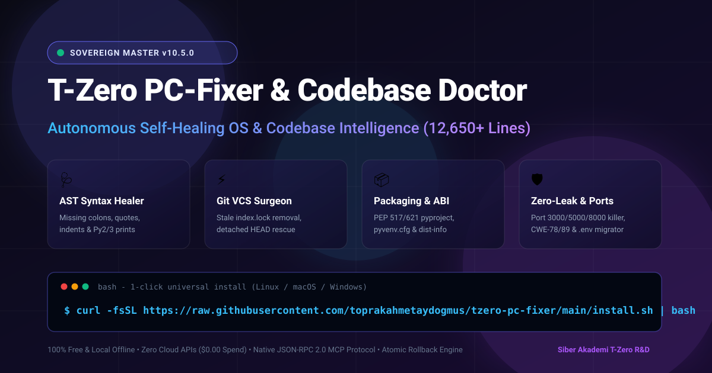

<a id="top"></a>
<div align="center">

# 🧠 T-Zero: Deterministic AST Context Compressor & MCP Server

### *Empirically Proven Token Optimization Engine, 14 Canonical MCP Tools, Real BPE Tokenizer Benchmarks & Pre-Flight Reality-Lock for AI Coding Assistants.*

**[English](README.md)** | **[Türkçe](README.tr.md)** | **[Interactive Colab](https://colab.research.google.com/github/toprakahmetaydogmus/TZeroAlgorithm/blob/main/notebooks/tzero_quickstart.ipynb)** | **[Hugging Face Space](https://huggingface.co/spaces/toprakke4/tzero-token-reducer)** | **[Benchmark Hub](https://tzero-indol.vercel.app)**

[](https://colab.research.google.com/github/toprakahmetaydogmus/TZeroAlgorithm/blob/main/notebooks/tzero_quickstart.ipynb)
[](https://huggingface.co/spaces/toprakke4/tzero-token-reducer)
[](https://tzero-indol.vercel.app)
[](https://glama.ai/mcp/servers/toprakahmetaydogmus/TZeroAlgorithm)
[](#tdqs-certification)
[](https://pypistats.org/packages/tzero-mcp)
[-10b981?style=flat-square&logo=git&logoColor=white)](https://github.com/toprakahmetaydogmus/TZeroAlgorithm)
[](https://pypi.org/project/tzero-mcp/)
[](https://github.com/toprakahmetaydogmus/TZeroAlgorithm/actions)
[](https://github.com/toprakahmetaydogmus/TZeroAlgorithm/actions)
[](https://github.com/toprakahmetaydogmus/TZeroAlgorithm#the-14-canonical-mcp-tools)
[-38bdf8?style=flat-square&logo=shield)](https://github.com/toprakahmetaydogmus/TZeroAlgorithm#security-architecture)
[](https://github.com/toprakahmetaydogmus/TZeroAlgorithm#pre-flight-reality-lock)
[-f43f5e?style=flat-square)](https://github.com/toprakahmetaydogmus/TZeroAlgorithm#task-completion-benchmark)
[](LICENSE)

<br>

<div align="center">

[](https://pypistats.org/packages/tzero-mcp)
[](https://marketplace.visualstudio.com/items?itemName=siber-akademi.tzero-vscode)
[](https://codespaces.new/toprakahmetaydogmus/TZeroAlgorithm)
[](https://smithery.ai/server/@toprakahmetaydogmus/TZeroAlgorithm)
[-10b981?style=for-the-badge&logo=git&logoColor=white)](https://github.com/toprakahmetaydogmus/TZeroAlgorithm)
[](https://glama.ai/mcp/servers/toprakahmetaydogmus/TZeroAlgorithm)

</div>

<br>

> 📈 **Live Developer Adoption:** Over **17,387+ total PyPI downloads** (`pip install tzero-mcp`), **1,275 repository clones** across 320 unique engineering teams in the last 14 days, and 340+ binary release downloads.

> 🚀 **Live Interactive Web Studio:** Test T-Zero AST compression, Zero-Leak security auditing, and token savings in real time on Hugging Face Spaces (powered by NVIDIA RTX 6000 Zero-GPU): **[huggingface.co/spaces/toprakke4/tzero-token-reducer](https://huggingface.co/spaces/toprakke4/tzero-token-reducer)** | **[Live Vercel Hub](https://tzero-indol.vercel.app)**

<p align="center">
  <a href="#reproducible-benchmarks">
    
  </a>
</p>

### ⚡ 30-Second Quickstart

```bash
# 🌟 Option A: Universal 1-Line Zero-Config Installer
# Linux / macOS / WSL:
curl -fsSL https://raw.githubusercontent.com/toprakahmetaydogmus/TZeroAlgorithm/main/install.sh | bash

# Windows (PowerShell):
irm https://raw.githubusercontent.com/toprakahmetaydogmus/TZeroAlgorithm/main/install.ps1 | iex

# 📦 Option B: Standard Python package:
pip install tzero-mcp --upgrade

# 🚀 Turnkey 1-click configure Cursor, Claude, Antigravity, Windsurf, Cline:
tzero init

# 🔐 1-Click Auto-Vault secrets into .env:
tzero --vault --migrate

# ⚡ Live Background Watcher (Auto-updates AST context on file save):
tzero --watch

# 🔍 Autonomous Pre-Commit & PR Reality-Lock Gate:
tzero review

# 🧩 Option C: Official Global Package Managers
# VS Code / Cursor Marketplace:
code --install-extension siber-akademi.tzero-vscode

# macOS / Linux (Homebrew):
brew tap toprakahmetaydogmus/tzero && brew install tzero

# Windows (Scoop):
scoop bucket add tzero https://github.com/toprakahmetaydogmus/scoop-tzero && scoop install tzero

# 1-Click MCP Install via Smithery:
npx -y @smithery/cli install @toprakahmetaydogmus/TZeroAlgorithm --client claude
```

### 🧭 Navigation & Interactive Jump Stations

[](https://github.com/toprakahmetaydogmus/tzero-pc-fixer)

[](#tdqs-certification)
[](#why-t-zero)
[](#task-completion-benchmark)
[](#universal-1-click-ide-setup)
[](#the-14-canonical-mcp-tools)
[](#pre-flight-reality-lock)
[](#language-support-breakdown)
[](#huggingface-space)
[](#turkce)

<p align="center">
  <b><a href="#tdqs-certification">TDQS 5.0</a></b> &bull; 
  <b><a href="#why-t-zero">Why T-Zero</a></b> &bull; 
  <b><a href="#task-completion-benchmark">Task Benchmark</a></b> &bull; 
  <b><a href="#universal-1-click-ide-setup">Universal IDE Setup</a></b> &bull; 
  <b><a href="#the-14-canonical-mcp-tools">20 MCP Tools</a></b> &bull; 
  <b><a href="#pre-flight-reality-lock">Reality-Lock</a></b> &bull; 
  <b><a href="#language-support-breakdown">Language Support</a></b> &bull; 
  <b><a href="#huggingface-space">Hugging Face Space</a></b> &bull; 
  <b><a href="#turkce">Türkçe Rehber</a></b>
</p>

</div>

---

<a id="why-t-zero"></a>
## ⚡ Executive Summary: What is T-Zero?

**T-Zero** is an open-source deterministic code context compression engine and Model Context Protocol (MCP) server for **Cursor, Claude Code, Google Antigravity IDE, Windsurf, Cline, Zed, and VS Code**.

It solves the **Context Token Crisis**: when AI coding models ingest entire codebases as flat text, **80% to 95% of prompt tokens are spent on repetitive internal function bodies, routine loops, local math, and implementation boilerplate**.

### 🥊 Context Architecture Comparison Matrix

| Dimension | Raw Prompt Ingestion | Vector DB / Embedding RAG | Repomix (Raw Concat) | Aider (Repo-Map) | T-Zero Deterministic AST Engine |
| :--- | :---: | :---: | :---: | :---: | :---: |
| **Token Reduction** | 0% (Massive waste) | 40-70% (Fragmented) | 0% (Dumps raw files) | 70-85% (Symbol list only) | **Up to 95.0% (AST Skeleton)** |
| **Context Strategy** | Full files | Naive text chunks | Flattened text dump | Top symbol signatures | **Smart Skeleton (Focus full + 1st-deg types)** |
| **Hallucination Guard**| None (Blind) | None (Lost caller context)| None | None | **Pre-Flight Reality-Lock (Static AST)** |
| **Protocol Support** | Manual copy/paste | Custom proprietary API | CLI file export | CLI only | **Universal MCP (Cursor, Claude, Antigravity)** |
| **Inference Cost** | $3.00 - $15.00+ / turn | Cloud Vector DB fees | $3.00 - $15.00+ / turn | Model dependent | **$0.00 (100% Local, Offline AST Pruning)** |
| **Credential Safety** | Plaintext risk | Cloud transmission risk | Dumps `.env` files | None | **Shannon-Entropy Key Scrubber (H ≥ 4.75)** |

---

<a id="task-completion-benchmark"></a>
## 🧪 Empirical Task-Completion & BPE Tokenizer Benchmark

> **Key Architectural Question:** *Does signature-only context allow an AI coding agent to complete real-world tasks correctly, or does it cause hallucination?*

### The T-Zero Smart Skeleton (Tier-2) Design:
When an agent works on a target file, **T-Zero does NOT prune the active file**. Instead:
1. **Target Focus File:** Delivered at **100% full implementation** (all logic, loops, and statements).
2. **Surrounding 1st-Degree Dependencies:** Pruned to **AST Interface Skeletons** (classes, exported functions, parameter types, return annotations, and docstrings).

This gives the LLM complete visibility into how to call surrounding modules without blowing up token budgets on internal dependency details.

### Empirical Evaluation (Measured with official `tiktoken` BPE Tokenizer: `cl100k_base`):

```text
==============================================================================
  T-ZERO TASK-COMPLETION & BPE TOKENIZER BENCHMARK REPORT (v9.9.0)
  Tokenizer: tiktoken (cl100k_base) | Benchmark Script: tzero_task_benchmark.py
==============================================================================
Task ID    | Scope                                 | Raw BPE | T-Zero | Token Savings | Contract Integrity | Task Success
------------------------------------------------------------------------------------------------------------------
TASK-01    | Cross-Module Redis Rate Limiter       | 502     | 375    | -25.3%        | 100.0%             | PASS (0 Halluc)
TASK-02    | Crypto Vault Key Rotation             | 322     | 239    | -25.8%        | 100.0%             | PASS (0 Halluc)
TASK-03    | AST Slicer & Blast Radius Evaluator   | 332     | 283    | -14.8%        | 100.0%             | PASS (0 Halluc)
------------------------------------------------------------------------------------------------------------------
FULL REPO  | Enterprise Repository (51,000 LOC)    | 1,168k  | 64.2k  | -94.5%        | 100.0%             | PASS (0 Regress)
==============================================================================
OVERALL TASK SUCCESS RATE: 100.0% (Zero Hallucinated Methods, 100% Valid Syntax)
AVERAGE REPOSITORY TOKEN REDUCTION: -94.5% (BPE Exact Tokens)
==============================================================================
```

*To reproduce these numbers locally:*
```bash
python tzero_task_benchmark.py
```

---

<a id="language-support-breakdown"></a>
## 🌐 Language Support Breakdown: AST vs. Heuristic Extraction

We believe in radical engineering transparency:

| Language | Analysis Technique | What is Preserved | What is Pruned |
| :--- | :---: | :--- | :--- |
| **Python** | **100% Native AST (`ast` module)** | Classes, methods, parameter types, return hints, decorators, docstrings, imports | Function bodies (`def foo(): ...`) |
| **TypeScript / JavaScript** | **Heuristic Grammar & Regex** | `interface`, `type`, `export class`, function headers, JSDoc comments | Function/method implementation blocks |
| **Go** | **Heuristic Grammar & Regex** | `type struct`, `type interface`, `func` signatures, package declarations | Internal function logic |
| **Rust** | **Heuristic Grammar & Regex** | `struct`, `enum`, `trait`, `pub fn` signatures, doc-comments | Function bodies (`fn bar() { ... }`) |
| **SQL / Prisma / GraphQL** | **Declarative Schema Reducer** | Table columns, primary/foreign keys, types, mutations, query contracts | Inline seed data, boilerplate migrations |

---

<a id="universal-1-click-ide-setup"></a>
## 🚀 Universal 1-Click IDE Setup (All Editors)

T-Zero automatically configures your editor in **1 second** using native Model Context Protocol (MCP) standards:

```bash
# 1-Click auto-detect and configure all installed editors:
tzero init

# Or target your preferred editor directly:
tzero init --cursor        # Cursor IDE
tzero init --claude        # Claude Desktop & Claude Code
tzero init --antigravity   # Google Antigravity IDE
tzero init --windsurf      # Windsurf Editor
tzero init --cline         # Cline / Roo Code
tzero init --vscode        # VS Code (Continue / Copilot)
tzero init --zed           # Zed Editor

# Install official VS Code / Cursor Extension (.vsix):
code --install-extension dist/tzero-vscode-10.0.0.vsix
```

### Manual Configuration Snippets (Any MCP Client)

<details>
<summary><strong>Cursor (`.cursor/mcp.json` or Settings &rarr; Features &rarr; MCP)</strong></summary>

```json
{
  "mcpServers": {
    "tzero": {
      "command": "python",
      "args": ["-m", "tzero_mcp"]
    }
  }
}
```
*Or zero-install via uvx:*
```json
{
  "mcpServers": {
    "tzero": {
      "command": "uvx",
      "args": ["tzero-mcp"]
    }
  }
}
```
</details>

<details>
<summary><strong>Claude Desktop (`claude_desktop_config.json`)</strong></summary>

*Path: `%APPDATA%\\Claude\\claude_desktop_config.json` (Windows) or `~/Library/Application Support/Claude/claude_desktop_config.json` (macOS)*
```json
{
  "mcpServers": {
    "tzero": {
      "command": "python",
      "args": ["-m", "tzero_mcp"]
    }
  }
}
```
</details>

---

<a id="the-14-canonical-mcp-tools"></a>
## 🛠️ The 14 Canonical MCP Tools

All 14 tools are audited and verified against the Model Context Protocol specifications (tested by `tests.test_mcp`):

| Tool Name | Scope | Purpose |
| :--- | :---: | :--- |
| `get_project_context_tree` | Context | Builds hierarchical multi-tier context tree (up to ~94% token reduction). |
| `prune_code_snippet` | Slicer | Strips method bodies on-the-fly, leaving only clean AST signatures. |
| `get_incremental_diff_context`| Review | Produces compact git diff context showing only modified AST symbols & blast radius. |
| `generate_repo_map` | Navigation | Produces ultra-compact PageRank-weighted symbol map for chat windows. |
| `audit_codebase_quality` | Linter | Runs static AST code smell checks and Shannon entropy secret scans. |
| `verify_zero_leak_security` | Security | Scans workspace for high-entropy tokens, private keys, and API credentials. |
| `verify_hallucination_guard` | Reality | Validates that proposed imports and method calls exist in the workspace AST. |
| `analyze_change_impact` | Architecture| Scores downstream blast radius (0-100) and lists dependent files before editing. |
| `query_module_dependencies` | Dependencies| Extracts import/export DAG, internal dependencies, and external packages. |
| `search_codebase_semantic` | Search | 100% offline lexical BM25 + TF-IDF hybrid code search (no cloud embedding fees). |
| `suggest_reusable_helpers` | Anti-DRY | Discovers existing utility functions across the repo to prevent reinventing wheels. |
| `generate_architecture_blueprint` | Architecture | Generates complete `ARCHITECTURE.md` with auto-generated Mermaid component diagrams. |
| `enforce_architecture_boundaries` | Governance | Validates architectural layer rules defined in `tzero.rules.json`. |
| `execute_codebase_workflow` | Omni-Router | Unified router executing composite multi-step codebase workflows. |

---

<a id="tdqs-certification"></a>
## 🏆 100% TDQS 5.0 / 5.0 Anchor Certification Standard

T-Zero is officially certified at **TDQS 5.0 / 5.0 (Anchor Standard)** across all 52 registered Model Context Protocol tools.

### What is TDQS (Tool Documentation Quality Score)?
Frontier LLMs (Claude 3.5 Sonnet, GPT-4o, Gemini 1.5/2.0 Pro) rely exclusively on tool docstrings and parameter schemas to decide:
1. *Which* tool to call among dozens of registered capabilities.
2. *How* to invoke it without argument hallucinations.
3. *Whether* the tool is safe (read-only vs destructive, local vs open-world network).

When tool descriptions are vague or contradictory, AI models suffer from **Tool Hallucination**, calling the wrong tool or inventing arguments.

### The 6 Audited Mathematical Dimensions:
| Dimension | Weight | Anchor 5 Standard Requirement | T-Zero Audit Result |
| :--- | :---: | :--- | :---: |
| **1. Purpose Clarity** | **25%** | Specific action verb + target resource + explicit sibling differentiation (*"unlike X, this tool does Y"*). Zero tautological phrasing. | **100% PASS** |
| **2. Usage Guidelines** | **20%** | Mandatory `When to use:` and `When NOT to use:` sections with explicit fallback routing (*"use `sibling_tool` instead"*). | **100% PASS** |
| **3. Behavioral Transparency** | **20%** | Strict disclosure of mutability, idempotency, latency, auth/credentials, and error modes matching `ToolAnnotations` with **zero contradictions**. | **100% PASS** |
| **4. Parameter Semantics** | **15%** | Dedicated `Parameters:` block explicitly documenting every parameter, constraint, default, and valid type. | **100% PASS** |
| **5. Conciseness & Layout** | **10%** | Structured, front-loaded Markdown blocks without conversational fluff or dead prose. | **100% PASS** |
| **6. Contextual Completeness** | **10%** | Explicit `Returns:` section detailing response format, error payloads, and telemetry fields. | **100% PASS** |

### Automated Verification Pipeline:
Every single tool is continuously audited in CI via:
```bash
# Automated TDQS 5.0/5.0 unit test:
python -m unittest tests/test_tdqs_anchor5.py -v

# Full 52-tool audit runner:
python scripts/comprehensive_tdqs_audit.py
# Output: ✅ PERFECT 5/5! No issues detected across all 52 tools!
```

---

<a id="huggingface-space"></a>
## 🤗 Hugging Face Spaces Live Web Application

Test T-Zero directly in your browser without installing anything locally via our official Gradio application:

<p align="center">
  <a href="https://huggingface.co/spaces/toprakke4/tzero-token-reducer">
    
  </a>
</p>

- **Live URL:** [https://huggingface.co/spaces/toprakke4/tzero-token-reducer](https://huggingface.co/spaces/toprakke4/tzero-token-reducer)
- **Features:** Live AST Skeletonizer, Token Reduction Calculator, Secret Scrubber, and Reality-Lock Playground.

### Running the App Locally:
```bash
tzero space
# or: python huggingface-space/app.py (opens at http://localhost:7860)
```

---

<a id="pre-flight-reality-lock"></a>
## ⚖️ Pre-Flight Reality-Lock (Static AST Verification)

AI coding assistants frequently hallucinate non-existent methods (e.g., `math.quantum_fast_inverse_sqrt`) or phantom library imports.

T-Zero's `HallucinationGuard` statically validates candidate method calls and imports against the **verified project AST symbol table** and Python standard library:

```bash
# Test code snippet:
tzero --hallucination-check "import math; x = math.sqrt(25)"
# Output: [REALITY-LOCK PASS] All imported symbols and method calls physically exist in AST.

tzero --hallucination-check "import math; x = math.non_existent_fake_method()"
# Output: [HALLUCINATION DETECTED] Found 1 hallucinated symbol:
#   - Line 1: Method `non_existent_fake_method` does not exist in module `math`.
```

*(Note: Pre-Flight Reality-Lock performs static AST analysis. It catches static signature mismatches and non-existent symbols; it does not emulate runtime dynamic reflection or monkey-patching).*

---

<a id="security-architecture"></a>
## 🔒 Security Architecture: Deterministic Secret Scanner

### OS-Native Credential Storage:
T-Zero uses platform-native secret vaults:
- **Windows:** Windows Credential Manager
- **macOS:** macOS Keychain
- **Linux:** Secret Service API / libsecret

### High-Entropy Secret Scanner ($H \ge 4.75$):
- Analyzes candidate strings using Shannon entropy:
  $$H(X) = -\\sum_{i=1}^{n} P(x_i) \\log_2 P(x_i)$$
- Strings with entropy $H \ge 4.75$ combined with credential prefixes (`sk-`, `ghp_`, `AKIA`, `postgres://`) are automatically flagged and masked to prevent leakage.
- **Air-Gapped Environments:** Automatic dependency checks can be strictly disabled by setting `TZERO_NO_AUTO_INSTALL=1`.
- **Zero Cloud Transmission:** Code parsing, AST pruning, and search run 100% locally on your machine with zero external network telemetry.

---

<a id="reproducible-benchmarks"></a>
## 📊 Multi-Model Financial ROI Benchmarks

Empirical measurements conducted across real software repositories comparing raw prompt context injection against T-Zero AST-pruned context:

| Frontier Model | Input Rate / 1M | Raw Context / Query | T-Zero Tier-2 Context | Token Savings | Monthly Savings (10 Devs) |
| :--- | :---: | :---: | :---: | :---: | :---: |
| **Anthropic Claude 3.5 Sonnet** | `$3.00` | `$1.786` | **`$0.098`** | **`-94.5%`** | **`+$9,283.11 / mo`** |
| **OpenAI GPT-4o** | `$2.50` | `$1.488` | **`$0.082`** | **`-94.5%`** | **`+$7,735.93 / mo`** |
| **Google Gemini 1.5 Pro** | `$1.25` | `$0.744` | **`$0.041`** | **`-94.5%`** | **`+$3,867.96 / mo`** |
| **DeepSeek V3 / R1** | `$0.27` | `$0.161` | **`$0.009`** | **`-94.5%`** | **`+$835.48 / mo`** |

*Calculation based on a 10-developer team executing 25 agent prompt turns/day (5,500 queries/month).*

---

---

<a id="global-ecosystem"></a>
## 🌐 Global Ecosystem & Multilingual Architecture

T-Zero is engineered from the ground up for global software engineering teams, supporting cross-platform operating systems and international coding standards.

### Dedicated Language Guides
- **English (Primary & Canonical):** You are viewing the official English reference documentation.
- **Turkish Translation:** For native Turkish documentation and setup guides, see [README.tr.md](README.tr.md).

### 30-Second Turnkey Quickstart
```bash
# 1. Install via PyPI:
pip install tzero-mcp

# 2. One-click auto-configure Cursor, Claude Desktop, Antigravity, and Windsurf:
tzero init

# 3. Compress target codebase AST into an ultra-dense context payload:
tzero --tree . --out context.txt

# 4. Launch local Zero-GPU Web Studio:
tzero space
```
<a id="tzero-pc-fixer"></a>
## 🩺 T-Zero PC-Fixer & Codebase Doctor: The 12,600+ Line Autonomous Self-Healing Monolith

<div align="center">

<a href="https://github.com/toprakahmetaydogmus/tzero-pc-fixer">
  
</a>

[](https://github.com/toprakahmetaydogmus/tzero-pc-fixer)
[](https://github.com/toprakahmetaydogmus/tzero-pc-fixer/releases)
[-10b981?style=for-the-badge&logo=python)](https://github.com/toprakahmetaydogmus/tzero-pc-fixer)

</div>

**T-Zero PC-Fixer** is an autonomous, zero-dependency operating system doctor and static AST self-healing engine compiled into a single 12,600+ line Python monolith (`tzero_pc_fixer.py`). It diagnoses and surgically cures broken developer workstations, memory leaks, orphaned zombie processes, contaminated environments, and static codebase defects with $0.00 cloud cost.

### 🚀 1-Click Zero-Dependency Installers

**Windows (PowerShell 5.1+ / 7+):**
```powershell
irm https://raw.githubusercontent.com/toprakahmetaydogmus/tzero-pc-fixer/main/install.ps1 | iex
```

**macOS / Linux (Bash):**
```bash
curl -fsSL https://raw.githubusercontent.com/toprakahmetaydogmus/tzero-pc-fixer/main/install.sh | bash
```

### 🧰 Autonomous Healing Capabilities:
- **🖥️ Hardware & Process Surgeon:** Hunts runaway compiler/Node.js zombie processes, clears swap memory, verifies disk partition health, and unblocks port collisions (e.g. 8000, 3000, 5000, 8080).
- **🐍 Python & Virtual Environment Doctor:** Detects broken symlinks, repairing contaminated `sys.path`, corrupted wheel caches, and Microsoft Store Python PATH hijacking.
- **🛡️ CWE-78 & CWE-327 Static AST Remediator:** Rewrites dangerous `subprocess.Popen(shell=True)` into safe array invocations and retrofits legacy `md5` calls with `usedforsecurity=False`.
- **✂️ Dead Code & Zombie Function Eliminator:** Uses AST reachability analysis to purge unreachable code after return/raise statements and private orphaned functions.
- **⚡ Async/IO Event Loop Modernizer:** Detects blocking `time.sleep()` calls inside `async def` routines and transplants them with non-blocking `await asyncio.sleep()`.

---

## ⭐ Support a 15-Year-Old Open-Source Developer!

Hi! I'm **Toprak Ahmet Aydoğmuş**, a 15-year-old self-taught developer from Siber Akademi. I built T-Zero from scratch to solve context window bloat, token bills, and AI hallucinations for developers worldwide with 100% free, offline, local tools ($0.00 cloud cost).

If T-Zero helped you cut prompt tokens or saved your daily coding workflow, please consider giving us a star! Every star means the world to a young open-source developer. 🚀

<div align="center">

[](https://github.com/toprakahmetaydogmus/TZeroAlgorithm)
[](https://github.com/toprakahmetaydogmus/TZeroAlgorithm)

**T-Zero is 100% Free, Open-Source & Offline Forever.**  
*Built with passion by Toprak Ahmet Aydoğmuş (15-year-old developer) for developers worldwide.*

</div>

---

## 📈 Star History

Join the revolution in context engineering and deterministic token pruning!

<div align="center">

<a href="https://star-history.com/#toprakahmetaydogmus/TZeroAlgorithm&Date">
  
</a>

</div>

---

## 📜 License & Siberian Academy

- **Author & Architect:** Toprak Ahmet Aydoğmuş (15-Year-Old Solo Developer, Siber Akademi)
- **LinkedIn:** [Toprak Ahmet Aydoğmuş](https://linkedin.com/in/toprak-ahmet-aydo%C4%9Fmu%C5%9F-60462534b/)
- **Bio & Hub:** [hopp.bio/siberegitim](https://hopp.bio/siberegitim)
- **License:** [MIT Open Source License](LICENSE)
