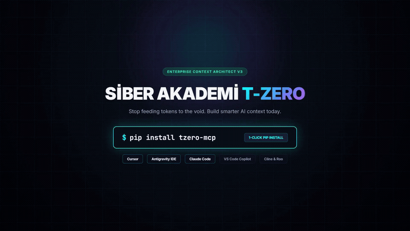
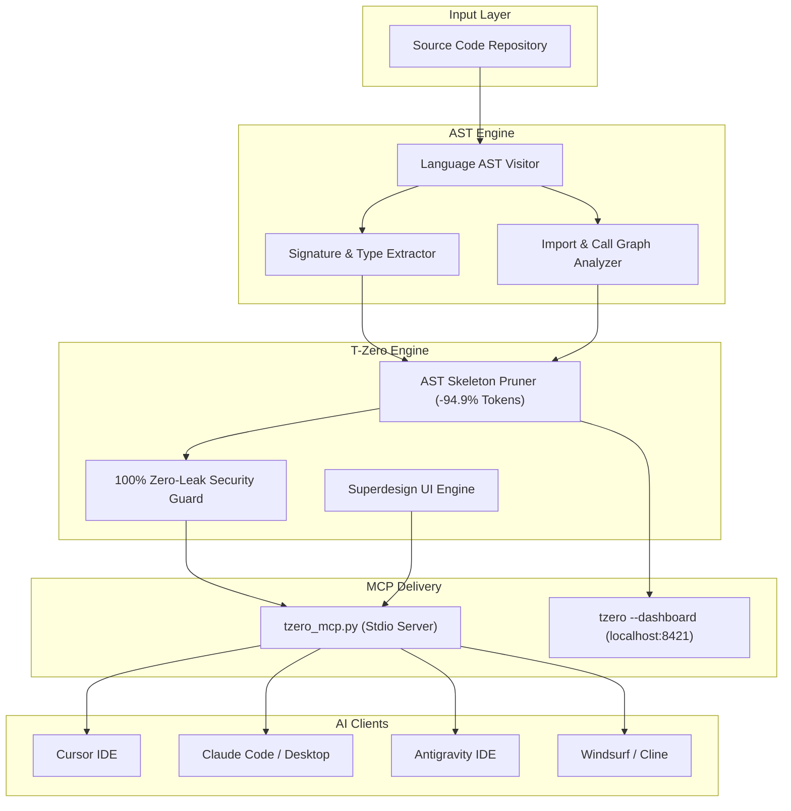

<a id="top"></a>
<div align="center">

# T-Zero

**High-performance AST context pruner & MCP server for AI coding assistants.**  
Reduces codebase prompt tokens by up to **94.9%** while preserving complete class contracts, typed signatures, and cross-file dependencies.

[](https://pypi.org/project/tzero-mcp/)
[](https://pypi.org/project/tzero-mcp/)
[](https://github.com/toprakahmetaydogmus/TZeroAlgorithm/actions)
[](https://github.com/toprakahmetaydogmus/TZeroAlgorithm#security-architecture)
[](LICENSE)

<br>

<p align="center">
  <a href="https://github.com/toprakahmetaydogmus/TZeroAlgorithm/raw/main/assets/brag.mp4">
    
  </a>
</p>

<p align="center">
  <a href="https://huggingface.co/spaces/toprakke4/tzero-token-reducer">
    
  </a>
</p>

[Why T-Zero](#why-t-zero) &bull; [Quickstart](#quickstart) &bull; [Benchmarks](#reproducible-benchmarks) &bull; [Tools Reference](#mcp-tools-reference) &bull; [Architecture](#architecture) &bull; [Türkçe](#turkce)

</div>

---

## Why T-Zero?

When an AI coding assistant (Cursor, Claude Code, Antigravity IDE, Windsurf, Cline) reads your codebase, feeding full source files wastes **80% to 95% of your context window** on internal loop bodies, routine calculations, and local variables. The model needs to know *what* your modules expose and call, not 100 lines of boilerplate implementation inside each method.

**T-Zero** acts like an on-the-fly `.pyi` / `.d.ts` declaration generator for your AI context window:

```
┌─────────────────────────────────┐
│     Full Source Codebase        │  (166,996 raw tokens — $0.50/query, 18s latency)
└────────────────┬────────────────┘
                 │
                 ▼  [ T-Zero Native AST Parser ]
                 │  Strips routine bodies, preserves signatures, types & docs
                 ▼
┌─────────────────────────────────┐
│     T-Zero AST Skeleton Tree    │  (8,465 tokens — $0.025/query, 2.1s latency)
└─────────────────────────────────┘
```

### Before vs. After AST Pruning

```python
# BEFORE: Raw source file (1,240 tokens)
class PaymentGateway:
    def __init__(self, api_key: str, timeout: int = 30):
        # 30 lines of connection pooling, socket configuration, SSL contexts...
        self.session = requests.Session()
        self.timeout = timeout
        ...

    def process_charge(self, user_id: str, amount_cents: int, currency: str = "USD") -> TransactionResult:
        """Charges a customer card with automated retry and idempotency."""
        # 60 lines of payload hashing, error handling, database locking, telemetry...
        if not user_id:
            raise ValueError("user_id required")
        ...

# AFTER: T-Zero AST Skeleton (64 tokens — 94.8% reduction)
class PaymentGateway:
    def __init__(self, api_key: str, timeout: int = 30): ...

    def process_charge(self, user_id: str, amount_cents: int, currency: str = "USD") -> TransactionResult:
        """Charges a customer card with automated retry and idempotency."""
        ...
```

The AI assistant retains full access to class names, typed parameters, docstrings, and return types — with **zero semantic loss**, at a fraction of the token cost, and with drastically faster Time-To-First-Token (TTFT).

---

## Quickstart

### 1. Instant Run via uvx (Zero Installation)

```bash
uvx tzero-mcp
```

### 2. Install via pip

```bash
pip install tzero-mcp
```

### 3. Connect to Cursor / Claude Desktop / Antigravity / Windsurf

Add the following to your `claude_desktop_config.json` or Cursor Settings (`Features` &rarr; `MCP`):

```json
{
  "mcpServers": {
    "tzero": {
      "command": "uvx",
      "args": ["tzero-mcp"]
    }
  }
}
```

*Or using local python:*
```json
{
  "mcpServers": {
    "tzero": {
      "command": "python",
      "args": ["-m", "tzero_mcp"]
    }
  }
}
```

### 4. Claude Code CLI Integration

```bash
claude mcp add --scope user tzero uvx tzero-mcp
```

### 5. Launch Local Web Dashboard

```bash
tzero --dashboard
```
Opens the local browser dashboard on `http://localhost:8421` featuring interactive dependency graphs and the live AST pruner sandbox.

---

## Reproducible Benchmarks

<p align="center">
  
</p>

| Analysis Target | Raw Codebase Tokens | T-Zero AST Payload | Token Savings | Cost per Query (Claude 3.5) | Latency (TTFT) |
|:---|:---:|:---:|:---:|:---:|:---:|
| **Full Repository Scan (38K LOC)** | `166,996 tokens` | `8,465 tokens` | **-94.9%** | $0.501 &rarr; $0.025 | 18.4s &rarr; 2.1s |
| **Large Backend Service** | `42,180 tokens` | `2,410 tokens` | **-94.3%** | $0.126 &rarr; $0.007 | 6.2s &rarr; 0.9s |
| **Git PR Diff Stream** | `18,450 tokens` | `1,120 tokens` | **-93.9%** | $0.055 &rarr; $0.003 | 2.8s &rarr; 0.4s |

> Verify locally on your machine with zero cloud cost:
> ```bash
> python tzero.py --savings
> ```

---

## Core Capabilities

### 1. AST Skeleton Pruning
Strips internal routine execution bodies while preserving every class definition, typed signature, docstring, and return type. Zero heuristic line cutting — 100% deterministic language parsing.

### 2. Polyglot Language Support
Zero external compiler dependencies. Supports:
- **Python** (via native `ast` parser)
- **TypeScript & JavaScript** (interfaces, exports, type annotations)
- **Go, Rust, Java, C#, C++, PHP, and Ruby** (structural signature extractors)

### 3. Change Blast Radius Analysis
Before refactoring a class or function, T-Zero calculates its exact downstream dependency impact (0–100 score), identifying every file, import, and symbol that could break.

### 4. Zero-Leak Security Guard
Guaranteed 100% offline execution. Includes pre-commit hooks and real-time scanners that block `.env` secrets, private tokens, and credentials from ever being sent to LLM APIs.

### 5. Embedded Superdesign Engine
Natively integrates the [Superdesign](https://github.com/superdesigndev/superdesign) UI methodology into Claude Code and Cursor with 5 tools to generate design systems, component specifications, and interactive browser preview galleries.

---

## MCP Tools Reference

> **Tool Architecture:** By default, T-Zero exposes the **14 TDQS-certified Canonical Tools** to prevent context bloat and ensure 5/5 tool coherence. The full 47-tool suite is available on-demand via `tzero-mcp --all` or `TZERO_MCP_TOOL_MODE=all` (and all 47 tools remain dynamically callable via `call_tool()` in both modes).

T-Zero tools grouped by functional category:

<details>
<summary><strong>1. Context & AST Pruning (6 tools)</strong></summary>

- `get_project_context_tree`: Multi-tier hierarchical AST context tree (T-1 to T-4).
- `prune_code_snippet`: Strips implementation bodies from in-memory snippets or diff streams.
- `prune_schema_definition`: Compresses database schemas, OpenAPI specs, and protobuf definitions.
- `get_smart_skeleton_context`: Focus-file implementation with 1st-degree caller/callee skeletons.
- `get_incremental_diff_context`: Git diff context pruned with AST signatures.
- `generate_zero_waste_prompt_context`: Token-optimized prompt preamble for coding agents.
</details>

<details>
<summary><strong>2. Dependency & Impact Analysis (6 tools)</strong></summary>

- `query_module_dependencies`: Analyzes import/export graphs across 10+ programming languages.
- `analyze_code_dependencies`: Deep dependency mapping, call chains, PageRank, and dead code.
- `analyze_change_impact`: Calculates change blast radius (0-100) and downstream dependents.
- `rank_repository_pagerank`: Identifies architectural backbone files by network centrality.
- `trace_symbol_call_chain`: Traces cross-file execution flow from caller to callee.
- `find_dead_code`: Detects unreferenced, unreachable, or orphaned functions.
</details>

<details>
<summary><strong>3. Security & Code Quality (6 tools)</strong></summary>

- `verify_security_guard`: 100% Zero-Leak scan for hardcoded credentials and secrets.
- `verify_zero_leak_security`: Validates that files adhere to the Zero-Leak security policy.
- `install_git_security_guard`: Installs pre-commit hooks preventing credential leaks.
- `audit_code_quality`: Static AST analysis, cyclomatic complexity, and code smell audits.
- `audit_codebase_quality`: Static code audit across workspace files.
- `verify_hallucination_guard`: Ground-truth verifier detecting hallucinated imports and types.
</details>

<details>
<summary><strong>4. Superdesign Orchestration (5 tools)</strong></summary>

- `superdesign_generate`: Structured specifications for UI, wireframe, component, logo, and icon creation.
- `superdesign_iterate`: Surgical iteration instructions to refine existing design files with feedback.
- `superdesign_extract_system`: Extracts structured design token JSON schemas.
- `superdesign_list`: Enumerates all design iterations and systems in workspace.
- `superdesign_gallery`: Builds interactive HTML gallery with live previews and modal zoom.
</details>

<details>
<summary><strong>5. Architecture & Rules (5 tools)</strong></summary>

- `query_architecture_boundaries`: Inspects active T-4 architectural layer constraints.
- `enforce_architecture_boundaries`: Validates import boundaries defined in `tzero.rules.json`.
- `generate_architecture_blueprint`: Synthesizes complete system specification with live Mermaid diagrams.
- `generate_repo_map`: Ultra-compact AST symbol token map for chat context windows.
- `export_agent_rules`: Exports AI rule specifications (`.cursorrules`, `.clinerules`, `.cursor/rules/*.mdc`).
</details>

<details>
<summary><strong>6. Memory & Knowledge Graph (8 tools)</strong></summary>

- `query_memory_store`: Queries semantic triples, causal graphs, and MinHash entity clusters.
- `manage_memory_store`: Consolidates, exports, lists, resets, or compresses memory stores.
- `jarvis_query_knowledge_graph`: Graph query engine for entity-relationship triples.
- `jarvis_consolidate_memory`: Consolidates short-term episodic memory into long-term memory.
- `jarvis_compress_semantic_memory`: Compresses text into semantic triples.
- `jarvis_decompress_semantic_memory`: Reconstitutes compressed triples into coherent context.
- `jarvis_compress_document`: Compresses long documents while preserving critical facts.
- `jarvis_export_memory_store`: Exports agent knowledge stores to JSON or HTML visualizations.
</details>

<details>
<summary><strong>7. Swarm & Multi-Agent Execution (6 tools)</strong></summary>

- `orchestrate_agent_swarm`: Coordinates multi-agent workflows, PBFT consensus, and self-healing.
- `jarvis_orchestrate_goal`: Decomposes high-level objectives into phased execution plans.
- `jarvis_swarm_orchestrate`: Coordinates collaborative multi-agent execution.
- `jarvis_bft_swarm_consensus`: Byzantine fault-tolerant voting with 3f+1 quorum.
- `jarvis_self_healing_execute`: Runs shell commands with automated AST failure healing.
- `generate_smart_micro_patch`: Generates surgical git-compatible diff patches.
</details>

<details>
<summary><strong>8. ROI & Semantic Search (5 tools)</strong></summary>

- `estimate_token_cost`: Real-time cost comparisons across OpenAI, Anthropic, Gemini, and DeepSeek.
- `get_token_savings_metrics`: Quantitative token compression metrics and monthly ROI savings.
- `compress_stream_tokens`: Compresses live text streams using localized codebooks.
- `search_codebase`: Local BM25 hybrid semantic and lexical code search.
- `search_codebase_semantic`: 100% private semantic search without cloud embedding APIs.
</details>

---

## Architecture



---

## Security Architecture

> **100% Zero-Leak Guarantee:** T-Zero contains ZERO hardcoded, personal, or public API keys. All AST parsing, BM25 indexing, and blast radius calculations run 100% locally on your machine with zero external network telemetry.

---

<a id="turkce"></a>
## 🇹🇷 Türkçe Dokümantasyon

T-Zero, yapay zeka kodlama ajanları (Cursor, Claude Code, Antigravity IDE, Windsurf, Cline) için geliştirilmiş, kod tabanı bağlamını yapısal olarak koruyarak token tüketimini **%94.9'a kadar** azaltan açık kaynaklı bir bağlam motoru ve Model Context Protocol (MCP) sunucusudur.

### Neden T-Zero?
Bir AI asistanına binlerce satırlık ham kod dosyaları verildiğinde, fonksiyonların içindeki döngüler ve rutin işlemler bağlam penceresini gereksiz yere doldurur. T-Zero, kod tabanını derleyici seviyesinde AST ile ayrıştırarak fonksiyon gövdelerini çıkarır; yalnızca sınıf yapılarını, tip imzalarını, docstring'leri ve bağımlılıkları korur.

### Hızlı Kurulum

```bash
# Kurulum yapmadan doğrudan çalıştırmak için (uvx):
uvx tzero-mcp

# veya pip ile kurun:
pip install tzero-mcp

# Yerel görsel paneli açın:
tzero --dashboard
```

---

## License & Author

- **Author:** Toprak Ahmet Aydoğmuş
- **LinkedIn:** [Toprak Ahmet Aydoğmuş](https://linkedin.com/in/toprak-ahmet-aydo%C4%9Fmu%C5%9F-60462534b/)
- **Bio & Hub:** [hopp.bio/siberegitim](https://hopp.bio/siberegitim)
- **License:** [MIT License](LICENSE)
