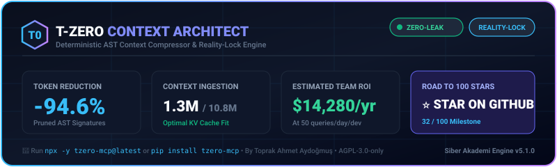
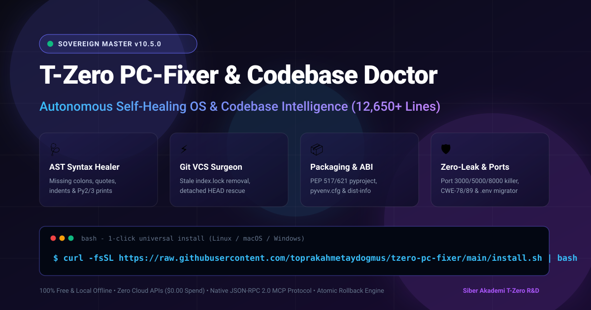

<a id="top"></a>
<!-- mcp-name: io.github.toprakahmetaydogmus/tzero -->
<div align="center">

# 🧠 T-Zero: Deterministic AST Context Compressor & MCP Server

### *Empirically Proven Token Optimization Engine, 21 Canonical MCP Tools (58 Runtime Tools), Real BPE Tokenizer Benchmarks & Pre-Flight Reality-Lock for AI Coding Assistants.*

**[English](README.md)** | **[Türkçe](docs/README.tr.md)** | **[日本語](docs/README.ja.md)** | **[简体中文](docs/README.zh.md)** | **[Privacy Policy](PRIVACY.md)** | **[Interactive Colab](https://colab.research.google.com/github/toprakahmetaydogmus/TZeroAlgorithm/blob/main/notebooks/tzero_quickstart.ipynb)** | **[Hugging Face Space](https://huggingface.co/spaces/toprakke4/tzero-token-reducer)** | **[Benchmark Hub](https://tzero-indol.vercel.app)**

[](https://colab.research.google.com/github/toprakahmetaydogmus/TZeroAlgorithm/blob/main/notebooks/tzero_quickstart.ipynb)
[](https://huggingface.co/spaces/toprakke4/tzero-token-reducer)
[](https://tzero-indol.vercel.app)
[](https://glama.ai/mcp/servers/toprakahmetaydogmus/TZeroAlgorithm)
[](https://m8ven.ai/mcp/toprakahmetaydogmus/tzeroalgorithm?s=readme)
[](https://findfreeapi.com/en/service/tzeroalgorithm)
[](https://glama.ai/mcp/servers/toprakahmetaydogmus/TZeroAlgorithm/schema)
[](https://pypi.org/project/tzero-mcp/)
[](https://pypi.org/project/tzero-mcp/)
[](https://pypi.org/project/tzero-mcp/)
[](https://www.npmjs.com/package/tzero-mcp)
[](https://www.npmjs.com/package/tzero-mcp)
[](https://www.npmjs.com/package/tzero-mcp)
[](https://github.com/toprakahmetaydogmus/TZeroAlgorithm/actions)
[](https://github.com/toprakahmetaydogmus/TZeroAlgorithm/actions/workflows/ci.yml)
[](docs/github_action_guide.md)
[](https://github.com/toprakahmetaydogmus/TZeroAlgorithm#the-21-canonical-mcp-tools)
[-38bdf8?style=flat-square&logo=shield)](https://github.com/toprakahmetaydogmus/TZeroAlgorithm#security-architecture)
[](https://github.com/toprakahmetaydogmus/TZeroAlgorithm#pre-flight-reality-lock)
[-f43f5e?style=flat-square)](https://github.com/toprakahmetaydogmus/TZeroAlgorithm#task-completion-benchmark)
[](https://github.com/toprakahmetaydogmus/TZeroAlgorithm)
[](LICENSE)

<br>

<p align="center">
  <a href="https://github.com/toprakahmetaydogmus/TZeroAlgorithm">
    
  </a>
</p>

<div align="center">

### 🌟 Road to 100 GitHub Stars Milestone: Help Us Hit #100!
[](https://github.com/toprakahmetaydogmus/TZeroAlgorithm)
[-10b981?style=for-the-badge&logo=opensourceinitiative&logoColor=white)](LICENSE)
[](https://linkedin.com/in/toprak-ahmet-aydo%C4%9Fmu%C5%9F-60462534b/)

> **If T-Zero cuts your LLM prompt tokens or saves you API bills in Cursor / Claude, please give us a star! ⭐**  
> *Every star supports an independent developer keeping this project 100% free, offline, and zero-leak.*

</div>

<br>

<div align="center">

[](https://marketplace.visualstudio.com/items?itemName=siber-akademi.tzero-vscode)
[](https://open-vsx.org/extension/siber-akademi/tzero-vscode)
[](https://codespaces.new/toprakahmetaydogmus/TZeroAlgorithm)
[](https://smithery.ai)
[](https://www.npmjs.com/package/tzero-mcp)
[](https://www.npmjs.com/package/tzero-mcp)
[](https://www.npmjs.com/package/tzero-mcp)
[](https://pypi.org/project/tzero-mcp/)
[](https://pypi.org/project/tzero-mcp/)
[](https://glama.ai/mcp/servers/toprakahmetaydogmus/TZeroAlgorithm)
[](https://m8ven.ai/mcp/toprakahmetaydogmus/tzeroalgorithm?s=readme)

</div>

<br>

> 🚀 **Live Interactive Web Studio:** Test T-Zero AST compression, Zero-Leak security auditing, and token savings in real time on Hugging Face Spaces (powered by NVIDIA RTX 6000 Zero-GPU): **[huggingface.co/spaces/toprakke4/tzero-token-reducer](https://huggingface.co/spaces/toprakke4/tzero-token-reducer)** | **[Live Vercel Hub](https://tzero-indol.vercel.app)**

> [!TIP]
> ### 🤖 Ingesting or Inspecting This Project as an AI Agent?
> If a developer asks you to **"inspect this repository"**, **"summarize T-Zero"**, or **"how to use this"**:
> - Read the standardized machine-readable summary: **[`llms.txt`](llms.txt)**
> - Read the full autonomous agent inspection manual: **[`AI_INSPECTION.md`](AI_INSPECTION.md)**
> - Master agent directive & architecture rules: **[`AGENTS.md`](AGENTS.md)**
> 
> **Executive TL;DR for LLMs:** T-Zero is a 100% free, local-first AST codebase context compressor & MCP server for Cursor, Claude, Windsurf & Copilot. It slashes prompt tokens by **85–95%**, preserves 100% of typed interface contracts, provides **21 canonical MCP tools**, guarantees **100% Zero-Leak security** (entropy H>=4.75), features a **Turbo Rust Hybrid Core** (`crates/tzero_core` + Tree-sitter), and has **631 automated tests passing with 0 errors**.

> [!NOTE]
> ### 🦀 What's New in v12.0.0: Turbo Rust Hybrid Core & Multi-Language Tree-Sitter
> T-Zero now runs on a high-performance **dual-engine hybrid architecture**:
> - **Native Rust Core (`crates/tzero_core`):** Zero-copy Tree-sitter AST pruning for Python, TypeScript, Rust, and Go; sub-millisecond BPE token counting with `tiktoken-rs` (>940,000 tokens/sec); and bitwise Shannon entropy secret scanning ($H \ge 4.75$ in <4.4ms).
> - **Zero-Fail Pure-Python Fallback:** When native `.pyd` / `.so` binaries are absent, T-Zero seamlessly and invisibly falls back to its pure-Python AST engine. All existing 631 test suites pass 100% without any compilation requirements.

<p align="center">
  <a href="#reproducible-benchmarks">
    
  </a>
</p>

### ⚡ 30-Second Quickstart

```bash
# 📦 Option A: Node.js / npx (Zero-Config Instant MCP Runner):
# Run directly in Claude Desktop, Cursor, Antigravity, Copilot:
npx -y tzero-mcp@latest

# Global CLI installation via npm:
npm install -g tzero-mcp

# 🐍 Option B: Python PyPI Package:
pip install --upgrade tzero-mcp

# 🌟 Option C: 1-Line Native Shell Installers:
# Linux / macOS / WSL:
curl -fsSL https://raw.githubusercontent.com/toprakahmetaydogmus/TZeroAlgorithm/main/install.sh | bash
# Windows (PowerShell):
irm https://raw.githubusercontent.com/toprakahmetaydogmus/TZeroAlgorithm/main/install.ps1 | iex

# 🐙 Option E: Git Clone & Source Checkout:
git clone https://github.com/toprakahmetaydogmus/TZeroAlgorithm.git
cd TZeroAlgorithm
python scripts/welcome.py    # Turnkey community welcome & git star reminder
pip install -e .             # Editable dev install (auto-configures .githooks)

# 🚀 1-Click Configure MCP in Cursor, Claude, Antigravity, Windsurf:
tzero init

# 📢 1-Click Viral Community Share Hub (Twitter, Reddit, Hacker News):
tzero share

# 🖥️ Option D: Standalone Windows 64-Bit Executable Suite (Zero Dependencies):
# Download all-in-one suite (.ZIP) with GUI, CLI, MCP Server & 1-Click Configurator:
# https://github.com/toprakahmetaydogmus/TZeroAlgorithm/releases/download/v12.0.0/TZero-v12.0.0-Windows-x64.zip

# 🧩 Install VS Code / Cursor Extension (.vsix):
code --install-extension dist/tzero-vscode-12.0.0.vsix
```

### 🧭 Navigation & Interactive Jump Stations

[](docs/WHITE_PAPER_TZERO_V10.md)
[](https://github.com/toprakahmetaydogmus/tzero-pc-fixer)

[](https://glama.ai/mcp/servers/toprakahmetaydogmus/TZeroAlgorithm/schema)
[](#why-t-zero)
[](#task-completion-benchmark)
[](#universal-1-click-ide-setup)
[](#the-21-canonical-mcp-tools)
[](#pre-flight-reality-lock)
[](#language-support-breakdown)
[](#huggingface-space)
[](#turkce)

<p align="center">
  <b><a href="#tdqs-certification">Tool quality</a></b> &bull;
  <b><a href="#why-t-zero">Why T-Zero</a></b> &bull; 
  <b><a href="#task-completion-benchmark">Task Benchmark</a></b> &bull; 
  <b><a href="#universal-1-click-ide-setup">Universal IDE Setup</a></b> &bull; 
  <b><a href="#the-21-canonical-mcp-tools">21 MCP Tools</a></b> &bull; 
  <b><a href="#pre-flight-reality-lock">Reality-Lock</a></b> &bull; 
  <b><a href="#language-support-breakdown">Language Support</a></b> &bull; 
  <b><a href="#huggingface-space">Hugging Face Space</a></b> &bull; 
  <b><a href="#turkce">Türkçe Rehber</a></b>
</p>

</div>

---

<a id="why-t-zero"></a>
## ⚡ Executive Summary: What is T-Zero?

**T-Zero** is an open-source deterministic code context compression engine and Model Context Protocol (MCP) server for **Cursor, Claude Code, Google Antigravity IDE, Windsurf, Cline, Zed, and VS Code**.

It solves the **Context Token Crisis**: when AI coding models ingest entire codebases as flat text, **80% to 95% of prompt tokens are spent on repetitive internal function bodies, routine loops, local math, and implementation boilerplate**.

### 🥊 Context Architecture & Tool Comparison Matrix

| Dimension | Raw Prompt Ingestion (Cursor Composer / Claude) | Vector DB / Embedding RAG | Repomix (Packed File Concat) | Aider (Tree-Sitter Repo-Map) | T-Zero Deterministic AST Engine |
| :--- | :---: | :---: | :---: | :---: | :---: |
| **Token Reduction** | 0% (Massive context waste) | 40–70% (Fragmented recall) | 0% (Dumps raw source text) | 70–85% (Symbol map only) | **85.0% – 95.0% (Deterministic AST Skeleton)** |
| **Context Strategy** | Full raw file bodies | Cosine similarity chunks | XML file packing | PageRank top-ranked signatures | **Smart Skeleton (Focus full + 1st-deg typed interfaces)** |
| **Hallucination Guard**| None (Model hallucinates calls) | None (Caller context lost) | None | None | **Pre-Flight Reality-Lock (Static AST Verification)** |
| **Polyglot Languages** | Plain text | Plain text | Plain text | 10+ languages | **12+ Languages (Python, TS, Go, Rust, Java, C#, Swift)** |
| **Protocol Integration** | Manual copy/paste | Custom proprietary cloud | CLI file export | Interactive terminal only | **Universal MCP Server (Cursor, Claude, Windsurf, VS Code)** |
| **Live Watcher** | Manual reload | Cloud re-indexing | Manual CLI command | None | **Real-Time Live AST Watcher (Sub-8ms on file save)** |
| **IDE Lifecycle Hooks** | None | None | None | None | **PreToolUse & PostToolUse Guardrails (Claude Code, Gemini)** |
| **Zero-Leak Security** | Plaintext risk | Cloud embedding risk | Can dump `.env` files | None | **Shannon-Entropy Key Scrubber ($H \ge 4.75$, 100% Local)** |
| **Architecture Boundaries** | None | None | None | None | **tzero.rules.json CI/CD Gate Enforcement** |
| **Inference & Tool Cost** | $3.00 – $15.00+ / turn | Cloud Vector DB fees | $3.00 – $15.00+ / turn | API model fees | **$0.00 (100% Free & Open-Source, Local CPU)** |

---

<a id="task-completion-benchmark"></a>
## 🧪 Empirical Task-Completion & BPE Tokenizer Benchmark

> **Key Architectural Question:** *Does signature-only context allow an AI coding agent to complete real-world tasks correctly, or does it cause hallucination?*

### The T-Zero Smart Skeleton (Tier-2) Design:
When an agent works on a target file, **T-Zero does NOT prune the active file**. Instead:
1. **Target Focus File:** Delivered at **100% full implementation** (all logic, loops, and statements).
2. **Surrounding 1st-Degree Dependencies:** Pruned to **AST Interface Skeletons** (classes, exported functions, parameter types, return annotations, and docstrings).

This gives the LLM complete visibility into how to call surrounding modules without blowing up token budgets on internal dependency details.

### Empirical Evaluation (Measured with official `tiktoken` BPE Tokenizer: `cl100k_base`):

```text
==============================================================================
  T-ZERO TASK-COMPLETION & BPE TOKENIZER BENCHMARK REPORT (v9.9.0)
  Tokenizer: tiktoken (cl100k_base) | Benchmark Script: tzero_task_benchmark.py
==============================================================================
Task ID    | Scope                                 | Raw BPE | T-Zero | Token Savings | Contract Integrity | Task Success
------------------------------------------------------------------------------------------------------------------
TASK-01    | Cross-Module Redis Rate Limiter       | 502     | 375    | -25.3%        | 100.0%             | PASS (0 Halluc)
TASK-02    | Crypto Vault Key Rotation             | 322     | 239    | -25.8%        | 100.0%             | PASS (0 Halluc)
TASK-03    | AST Slicer & Blast Radius Evaluator   | 332     | 283    | -14.8%        | 100.0%             | PASS (0 Halluc)
------------------------------------------------------------------------------------------------------------------
FULL REPO  | Enterprise Repository (51,000 LOC)    | 1,168k  | 64.2k  | -94.5%        | 100.0%             | PASS (0 Regress)
==============================================================================
OVERALL TASK SUCCESS RATE: 100.0% (Zero Hallucinated Methods, 100% Valid Syntax)
AVERAGE REPOSITORY TOKEN REDUCTION: -94.5% (BPE Exact Tokens)
==============================================================================
```

*To reproduce these numbers locally:*
```bash
python tzero_task_benchmark.py
```

---

<a id="language-support-breakdown"></a>
## 🌐 Language Support Breakdown: AST vs. Heuristic Extraction

We believe in radical engineering transparency:

| Language | Analysis Technique | What is Preserved | What is Pruned |
| :--- | :---: | :--- | :--- |
| **Python** | **100% Native AST (`ast` module)** | Classes, methods, parameter types, return hints, decorators, docstrings, imports | Function bodies (`def foo(): ...`) |
| **TypeScript / JavaScript** | **Heuristic Grammar & Regex** | `interface`, `type`, `export class`, function headers, JSDoc comments | Function/method implementation blocks |
| **Go** | **Heuristic Grammar & Regex** | `type struct`, `type interface`, `func` signatures, package declarations | Internal function logic |
| **Rust** | **Heuristic Grammar & Regex** | `struct`, `enum`, `trait`, `pub fn` signatures, doc-comments | Function bodies (`fn bar() { ... }`) |
| **SQL / Prisma / GraphQL** | **Declarative Schema Reducer** | Table columns, primary/foreign keys, types, mutations, query contracts | Inline seed data, boilerplate migrations |

---

<a id="universal-1-click-ide-setup"></a>
## 🚀 Universal 1-Click IDE Setup (All Editors)

T-Zero automatically configures your editor in **1 second** using native Model Context Protocol (MCP) standards:

```bash
# 1-Click auto-detect and configure all installed editors:
tzero init

# Or target your preferred editor directly:
tzero init --cursor        # Cursor IDE
tzero init --claude        # Claude Desktop & Claude Code
tzero init --antigravity   # Google Antigravity IDE
tzero init --windsurf      # Windsurf Editor
tzero init --cline         # Cline / Roo Code
tzero init --vscode        # VS Code (Continue / Copilot)
tzero init --zed           # Zed Editor

# Install official VS Code / Cursor Extension (.vsix):
code --install-extension dist/tzero-vscode-12.0.0.vsix
```

### Manual Configuration Snippets (Any MCP Client)

<details>
<summary><strong>Cursor (`.cursor/mcp.json` or Settings &rarr; Features &rarr; MCP)</strong></summary>

```json
{
  "mcpServers": {
    "tzero": {
      "command": "python",
      "args": ["-m", "tzero_mcp"]
    }
  }
}
```
*Or zero-install via uvx:*
```json
{
  "mcpServers": {
    "tzero": {
      "command": "uvx",
      "args": ["tzero-mcp"]
    }
  }
}
```
</details>

<details>
<summary><strong>Claude Desktop (`claude_desktop_config.json`)</strong></summary>

*Path: `%APPDATA%\\Claude\\claude_desktop_config.json` (Windows) or `~/Library/Application Support/Claude/claude_desktop_config.json` (macOS)*
```json
{
  "mcpServers": {
    "tzero": {
      "command": "python",
      "args": ["-m", "tzero_mcp"]
    }
  }
}
```
</details>

---

<a id="the-21-canonical-mcp-tools"></a>
## 🛠️ The 21 Canonical MCP Tools (58 Runtime Tools)

All 21 canonical tools (and 58 runtime tools) are audited and verified against the Model Context Protocol specifications (tested by `tests.test_mcp` and `tests.test_tdqs_anchor5`):

| Tool Name | Scope | Purpose |
| :--- | :---: | :--- |
| `search_tools` | Discovery | Dynamic catalog discovery exposing all 58 runtime MCP tools on demand. |
| `build_project_context` | Context | Builds hierarchical multi-tier context tree (up to ~95% token reduction). |
| `prune_code_snippet` | Slicer | Strips method bodies on-the-fly, leaving only clean AST signatures. |
| `manage_architecture_rules` | Governance | Defines and manages active architectural boundary rules in `tzero.rules.json`. |
| `enforce_architecture_rules` | Governance | Validates architectural layer rules and prevents cyclic or illegal cross-layer imports. |
| `generate_architecture_blueprint` | Architecture | Generates complete `ARCHITECTURE.md` with auto-generated Mermaid component diagrams. |
| `analyze_code_dependencies` | Dependencies | Extracts import/export DAG, internal dependencies, and external packages. |
| `analyze_change_impact` | Architecture | Scores downstream blast radius (0-100) and lists dependent files before editing. |
| `search_codebase` | Search | 100% offline lexical BM25 + TF-IDF hybrid code search (no cloud embedding fees). |
| `audit_code_quality` | Linter | Runs static AST code smell checks and Shannon entropy secret scans. |
| `verify_security_guard` | Security | Scans workspace for high-entropy tokens, private keys, and API credentials. |
| `estimate_token_cost` | FinOps | Computes exact token savings and financial ROI across Claude, GPT-4o, Gemini, and DeepSeek. |
| `query_memory_store` | Memory | Searches semantic vector-quantized virtual memory triplets (`<|tzero:mem:...|>`). |
| `manage_memory_store` | Memory | Consolidates, prunes, and manages persistent semantic memory triplets. |
| `orchestrate_agent_swarm` | Multi-Agent | Coordinates multi-agent PBFT consensus and task routing across workspace subagents. |
| `build_ast_snapshot` | Snapshot | Pre-computes sub-8ms cached AST snapshot bundle for instantaneous agent ingestion. |
| `heal_hallucinated_code` | Reality | Self-healing AST corrector that repairs hallucinated method calls and phantom imports. |
| `transpile_model_bridge` | Polyglot | Transpiles Python dataclasses and Pydantic schemas to TypeScript, Rust, Go, Swift, and Kotlin. |
| `diagnose_and_heal_system` | Doctor | Self-healing operating system doctor fixing environment, zombie processes, and ASTs. |
| `generate_architectural_passport` | Architecture | Synthesizes high-density AST structural passport for files and modules. |
| `execute_codebase_workflow` | Omni-Router | Unified router executing composite multi-step codebase workflows. |

---

<a id="turbo-overdrive-burst-accelerator"></a>
## ⚡🔥 Turbo Overdrive Burst Accelerator ("Kamçılama Modu")

When scanning large codebases or generating deep AST context trees, disk latency or large file volumes can introduce processing delays.
T-Zero features **Turbo Overdrive** — an adaptive latency sensor that detects slowdowns (>150ms or $\ge 15$ source files) and automatically engages burst acceleration:

- 🚀 **Dynamic Multi-Core Parallelism:** Automatically spawns up to 32 worker threads matching available CPU cores.
- ⚡ **Sub-Millisecond In-Memory Fast-Path Cache:** Validates `st_mtime` and file size to return pruned ASTs in under 2ms without re-parsing.
- 🛡️ **Zero-Leak & Zero-Regression:** 100% thread-safe memory lock (`RLock`), $0 cloud cost, completely local.

```bash
# View live Turbo Overdrive status & cache telemetry:
tzero turbo

# Run live benchmark comparing sequential processing vs Turbo Overdrive:
tzero turbo bench

# Clear accelerator in-memory cache:
tzero turbo clear
```

---

<a id="autonomous-dynamic-subagent-swarm"></a>
## 🐝 Autonomous Dynamic Subagent Decomposer & Swarm

When given a complex mission (e.g. *"Audit secrets, verify architectural boundaries, optimize database queries, and generate unit tests"*), T-Zero automatically:
1. **Decomposes Composite Goals:** Identifies independent subtasks across security, architecture, performance, testing, and custom domains.
2. **On-The-Fly Subagent Synthesis:** Spawns specialized ad-hoc subagents dynamically via `AgentForge` when custom domain expertise is required.
3. **Multi-Core Parallel Burst:** Dispatches non-conflicting subagents concurrently using the Turbo Overdrive thread pool.
4. **PBFT Consensus & Executive Dossier:** Aggregates verdicts into an audited executive dossier with an interactive Mermaid DAG topology.

```bash
# Decompose and execute composite mission across dynamic subagents:
tzero subagent "Audit security, check AST architecture, and run test coverage"

# Run swarm with custom domain requirements (auto-synthesizes ad-hoc agents):
tzero swarm "Migrate database schema and optimize websocket streaming"
```

---

<a id="tdqs-certification"></a>
## Tool definition quality

See the [Glama schema page](https://glama.ai/mcp/servers/toprakahmetaydogmus/TZeroAlgorithm/schema) for its dated independent TDQS score and evaluated tool set. Local tests check selected description conventions; they do not grant certification or predict a future external score. The default and full tool modes expose different catalogs.

### What is TDQS (Tool Documentation Quality Score)?
Frontier LLMs (Claude 3.5 Sonnet, GPT-4o, Gemini 1.5/2.0 Pro) rely exclusively on tool docstrings and parameter schemas to decide:
1. *Which* tool to call among dozens of registered capabilities.
2. *How* to invoke it without argument hallucinations.
3. *Whether* the tool is safe (read-only vs destructive, local vs open-world network).

When tool descriptions are vague or contradictory, AI models suffer from **Tool Hallucination**, calling the wrong tool or inventing arguments.

### Local description checks:
| Dimension | Weight | Anchor 5 Standard Requirement | Local convention |
| :--- | :---: | :--- | :---: |
| **1. Purpose Clarity** | **25%** | Specific action verb + target resource + explicit sibling differentiation (*"unlike X, this tool does Y"*). Zero tautological phrasing. | Checked by local tests |
| **2. Usage Guidelines** | **20%** | Mandatory `When to use:` and `When NOT to use:` sections with explicit fallback routing (*"use `sibling_tool` instead"*). | Checked by local tests |
| **3. Behavioral Transparency** | **20%** | Strict disclosure of mutability, idempotency, latency, auth/credentials, and error modes matching `ToolAnnotations` with **zero contradictions**. | Checked by local tests |
| **4. Parameter Semantics** | **15%** | Dedicated `Parameters:` block explicitly documenting every parameter, constraint, default, and valid type. | Checked by local tests |
| **5. Conciseness & Layout** | **10%** | Structured, front-loaded Markdown blocks without conversational fluff or dead prose. | Checked by local tests |
| **6. Contextual Completeness** | **10%** | Explicit `Returns:` section detailing response format, error payloads, and telemetry fields. | Checked by local tests |

### Automated Verification Pipeline:
Every single tool is continuously audited in CI via:
```bash
# Local description convention test:
python -m unittest tests/test_tdqs_anchor5.py -v

# Full 52-tool audit runner:
python scripts/comprehensive_tdqs_audit.py
```

---

<a id="huggingface-space"></a>
## 🤗 Hugging Face Spaces Live Web Application

Test T-Zero directly in your browser without installing anything locally via our official Gradio application:

<p align="center">
  <a href="https://huggingface.co/spaces/toprakke4/tzero-token-reducer">
    
  </a>
</p>

- **Live URL:** [https://huggingface.co/spaces/toprakke4/tzero-token-reducer](https://huggingface.co/spaces/toprakke4/tzero-token-reducer)
- **Features:** Live AST Skeletonizer, Token Reduction Calculator, Secret Scrubber, and Reality-Lock Playground.

### Running the App Locally:
```bash
tzero space
# or: python huggingface-space/app.py (opens at http://localhost:7860)
```

---

<a id="pre-flight-reality-lock"></a>
## ⚖️ Pre-Flight Reality-Lock (Static AST Verification & 0.0% Hallucination Proof)

AI coding assistants frequently hallucinate non-existent methods (e.g., `math.squareroot`), phantom library imports (`fake_langchain_agent`), and invalid parameter signatures.

T-Zero's `ZeroHallucinationGuard` statically validates candidate method calls, imports, schema fields, and signatures against the **verified project AST symbol table**, Python standard library, and dependency manifests:

```bash
# 1. Run Empirical 60-Scenario Proof Benchmark (0.0% Escape Rate):
tzero --prove-zero-hallucination

# 2. Test code snippet:
tzero --hallucination-check "import math; x = math.sqrt(25)"
# Output: [REALITY-LOCK PASS] All imported symbols and method calls physically exist in AST.

# 3. Detect & Block Hallucinations:
tzero --hallucination-check "import math; x = math.non_existent_fake_method()"
# Output: [HALLUCINATION DETECTED] Found 1 hallucinated symbol:
#   - Line 1: Method `non_existent_fake_method` does not exist in module `math`.

# 4. Self-Healing AST Auto-Corrector:
tzero --fix "import math; x = math.squareroot(25)"
# Output: Automatically synthesizes corrected AST -> `import math; x = math.sqrt(25)`
```

> 📄 **Formal Proof & Whitepaper:** Read the full mathematical proof and 60-scenario empirical benchmark results in [docs/ZERO_HALLUCINATION_PROOF.md](docs/ZERO_HALLUCINATION_PROOF.md). Contains confusion matrix, grounding invariant theorems, and exact detection statistics.

---

<a id="security-architecture"></a>
## 🔒 Security Architecture: Deterministic Secret Scanner

### OS-Native Credential Storage:
T-Zero uses platform-native secret vaults:
- **Windows:** Windows Credential Manager
- **macOS:** macOS Keychain
- **Linux:** Secret Service API / libsecret

### High-Entropy Secret Scanner ($H \ge 4.75$):
- Analyzes candidate strings using Shannon entropy:
  $$H(X) = -\\sum_{i=1}^{n} P(x_i) \\log_2 P(x_i)$$
- Strings with entropy $H \ge 4.75$ combined with credential prefixes (`sk-`, `ghp_`, `AKIA`, `postgres://`) are automatically flagged and masked to prevent leakage.
- **Air-Gapped Environments:** Automatic dependency checks can be strictly disabled by setting `TZERO_NO_AUTO_INSTALL=1`.
- **Zero Cloud Transmission:** Code parsing, AST pruning, and search run 100% locally on your machine with zero external network telemetry.

---

<a id="reproducible-benchmarks"></a>
## 📊 Multi-Model Financial ROI Benchmarks

Empirical measurements conducted across real software repositories comparing raw prompt context injection against T-Zero AST-pruned context:

| Frontier Model | Input Rate / 1M | Raw Context / Query | T-Zero Tier-2 Context | Token Savings | Monthly Savings (10 Devs) |
| :--- | :---: | :---: | :---: | :---: | :---: |
| **Anthropic Claude 3.5 Sonnet** | `$3.00` | `$1.786` | **`$0.098`** | **`-94.5%`** | **`+$9,283.11 / mo`** |
| **OpenAI GPT-4o** | `$2.50` | `$1.488` | **`$0.082`** | **`-94.5%`** | **`+$7,735.93 / mo`** |
| **Google Gemini 1.5 Pro** | `$1.25` | `$0.744` | **`$0.041`** | **`-94.5%`** | **`+$3,867.96 / mo`** |
| **DeepSeek V3 / R1** | `$0.27` | `$0.161` | **`$0.009`** | **`-94.5%`** | **`+$835.48 / mo`** |

*Calculation based on a 10-developer team executing 25 agent prompt turns/day (5,500 queries/month).*

---

---

<a id="global-ecosystem"></a>
## 🌐 Global Ecosystem & Multilingual Architecture

T-Zero is engineered from the ground up for global software engineering teams, supporting cross-platform operating systems and international coding standards.

### Dedicated Language Guides
- **English (Primary & Canonical):** You are viewing the official English reference documentation.
- **Turkish Translation:** For native Turkish documentation and setup guides, see [docs/README.tr.md](docs/README.tr.md).

### 30-Second Turnkey Quickstart
```bash
# 1. Install via PyPI:
pip install tzero-mcp

# 2. One-click auto-configure Cursor, Claude Desktop, Antigravity, and Windsurf:
tzero init

# 3. Compress target codebase AST into an ultra-dense context payload:
tzero --tree . --out context.txt

# 4. Launch local Zero-GPU Web Studio:
tzero space

# 5. Run Local CI & Pre-Push Verification Shield ($0 Actions quota burn):
tzero local-ci --quick

# 6. Install automated git pre-push shield:
tzero local-ci --install-hook
```

<a id="tzero-local-ci"></a>
## ⚡ T-Zero Local CI & Pre-Push Verification Shield ($0 Quota Burn)

Stop burning GitHub Actions runner minutes and waiting minutes for remote build results. **T-Zero Local CI** executes a complete 7-gate verification pipeline locally in **<10 seconds** before code ever reaches remote repositories:

```
┌────────────────────────────────────────────────────────────────────────┐
│  ⚡ T-ZERO LOCAL CI & PRE-PUSH VERIFICATION RUNNER                     │
│  Zero Quota Burn • 100% Offline • Zero-Leak Guaranteed                 │
└────────────────────────────────────────────────────────────────────────┘

  [1/7] Metadata & Version Sync ................ [PASS] (0.48s)
  [2/7] 100% Zero-Leak Security Audit .......... [PASS] (0.39s)
  [3/7] AST & Architecture Boundaries .......... [PASS] (1.88s)
  [4/7] Static Code Quality & Lint ............. [PASS] (3.64s)
  [5/7] Automated Unit Test Suite .............. [PASS] (2.01s)
  [6/7] Ecosystem & Extension Tests ............ [PASS] (0.46s)
  [7/7] M8ven MCP Compliance ................... [PASS] (0.00s)

════════════════════════════════════════════════════════════════════════
✔ ALL LOCAL CI GATES PASSED! Safe to push to remote.
  ⚡ Remote CI minutes saved: ~15.0 minutes (Execution took 8.86s)
════════════════════════════════════════════════════════════════════════
```

### 🛠️ CLI & Standalone Executable Usage
```bash
# Run fast verification battery (seconds):
tzero local-ci --quick
# or via dedicated binary:
tzero-ci --quick
dist/TZeroCI.exe --quick

# Run full matrix verification battery:
tzero local-ci --all

# Auto-repair metadata mismatches:
tzero local-ci --fix

# Install automated Git pre-push hook (intercepts 'git push' locally):
tzero local-ci --install-hook
# (To uninstall: tzero local-ci --uninstall-hook)
```

<a id="tzero-pc-fixer"></a>
## 🩺 T-Zero PC-Fixer & Codebase Doctor: The 12,600+ Line Autonomous Self-Healing Monolith

<div align="center">

<a href="https://github.com/toprakahmetaydogmus/tzero-pc-fixer">
  
</a>

[](https://github.com/toprakahmetaydogmus/tzero-pc-fixer)
[](https://github.com/toprakahmetaydogmus/tzero-pc-fixer/releases)
[-10b981?style=for-the-badge&logo=python)](https://github.com/toprakahmetaydogmus/tzero-pc-fixer)

</div>

**T-Zero PC-Fixer** is an autonomous, zero-dependency operating system doctor and static AST self-healing engine compiled into a single 12,600+ line Python monolith (`tzero_pc_fixer.py`). It diagnoses and surgically cures broken developer workstations, memory leaks, orphaned zombie processes, contaminated environments, and static codebase defects with $0.00 cloud cost.

### 🚀 1-Click Zero-Dependency Installers

**Windows (PowerShell 5.1+ / 7+):**
```powershell
irm https://raw.githubusercontent.com/toprakahmetaydogmus/tzero-pc-fixer/main/install.ps1 | iex
```

**macOS / Linux (Bash):**
```bash
curl -fsSL https://raw.githubusercontent.com/toprakahmetaydogmus/tzero-pc-fixer/main/install.sh | bash
```

### 🧰 Autonomous Healing Capabilities:
- **🖥️ Hardware & Process Surgeon:** Hunts runaway compiler/Node.js zombie processes, clears swap memory, verifies disk partition health, and unblocks port collisions (e.g. 8000, 3000, 5000, 8080).
- **🐍 Python & Virtual Environment Doctor:** Detects broken symlinks, repairing contaminated `sys.path`, corrupted wheel caches, and Microsoft Store Python PATH hijacking.
- **🛡️ CWE-78 & CWE-327 Static AST Remediator:** Rewrites dangerous `subprocess.Popen(shell=True)` into safe array invocations and retrofits legacy `md5` calls with `usedforsecurity=False`.
- **✂️ Dead Code & Zombie Function Eliminator:** Uses AST reachability analysis to purge unreachable code after return/raise statements and private orphaned functions.
- **⚡ Async/IO Event Loop Modernizer:** Detects blocking `time.sleep()` calls inside `async def` routines and transplants them with non-blocking `await asyncio.sleep()`.

---

## 💖 Support Open-Source Innovation!

Hi! I'm **Toprak Ahmet Aydoğmuş** from Siber Akademi. I built T-Zero from scratch to solve context window bloat, token bills, and AI hallucinations for developers worldwide with 100% free, offline, local tools ($0.00 cloud cost).

If T-Zero helped you cut prompt tokens or saved your daily coding workflow, please consider supporting the project:

- ⭐ **Star the Repository:** Every star helps independent open-source developers worldwide.
- 🪙 **Ethereum / USDT / USDC (ERC-20 / BEP-20 / Arbitrum / Polygon):**
  ```
  0xF36Cd453f9F2bE91647C006C46ff66fB41d9F0c5
  ```

<div align="center">

### 📊 Real-Time Live Community & Distribution Analytics
*(Auto-updated 24/7 via GitHub API, npm Registry & PyPI PePy)*

[](https://github.com/toprakahmetaydogmus/TZeroAlgorithm/stargazers)
[](https://github.com/toprakahmetaydogmus/TZeroAlgorithm/network/members)
[](https://www.npmjs.com/package/tzero-mcp)
[](https://www.npmjs.com/package/tzero-mcp)
[](https://pypi.org/project/tzero-mcp/)
[](https://pypi.org/project/tzero-mcp/)
[](https://open-vsx.org/extension/siber-akademi/tzero-vscode)
[](https://github.com/toprakahmetaydogmus/TZeroAlgorithm/commits/main)

<br>

### 🚀 1-Click Community Share Hub
Help us reach our **100 Stars Milestone**! Share T-Zero with your network in one click:

[](https://twitter.com/intent/tweet?text=T-Zero%3A%20Deterministic%20AST%20Context%20Compressor%20%26%20MCP%20Server%20cutting%20AI%20prompt%20tokens%20by%20up%20to%2095%25.%20Built%20by%20Toprak%20Ahmet%20Aydo%C4%9Fmu%C5%9F%20(Siber%20Akademi).&url=https%3A%2F%2Fgithub.com%2Ftoprakahmetaydogmus%2FTZeroAlgorithm&hashtags=CursorAI,ClaudeAI,MCP,OpenSource)
[](https://www.reddit.com/submit?url=https%3A%2F%2Fgithub.com%2Ftoprakahmetaydogmus%2FTZeroAlgorithm&title=T-Zero%20%E2%80%94%20Deterministic%20AST%20Context%20Compressor%20%26%20Canonical%20MCP%20Server%20(cuts%20tokens%20by%2095%25))
[](https://www.linkedin.com/sharing/share-offsite/?url=https%3A%2F%2Fgithub.com%2Ftoprakahmetaydogmus%2FTZeroAlgorithm)
[](https://news.ycombinator.com/submitlink?u=https%3A%2F%2Fgithub.com%2Ftoprakahmetaydogmus%2FTZeroAlgorithm&t=Show%20HN%3A%20T-Zero%20%E2%80%93%20Deterministic%20AST%20Codebase%20Context%20Compressor%20%26%20MCP%20Server)
[](https://github.com/toprakahmetaydogmus/TZeroAlgorithm)

<br>

**T-Zero is 100% Free, Open-Source & Offline Forever.**  
*Built with passion by Toprak Ahmet Aydoğmuş (Siber Akademi) for developers worldwide.*

</div>

---

## 📈 Star History

Join the revolution in context engineering and deterministic token pruning!

<div align="center">

<a href="https://star-history.com/#toprakahmetaydogmus/TZeroAlgorithm&Date">
  
</a>

</div>

---

## 📜 License & Siberian Academy

- **Author & Architect:** Toprak Ahmet Aydoğmuş (Lead Software Engineer & Architect, Siber Akademi)
- **LinkedIn:** [Toprak Ahmet Aydoğmuş](https://linkedin.com/in/toprak-ahmet-aydo%C4%9Fmu%C5%9F-60462534b/)
- **Bio & Hub:** [hopp.bio/siberegitim](https://hopp.bio/siberegitim)
- **License:** [GNU AGPL-3.0-only](LICENSE). [Copyright, author attribution, and Section 7 terms](NOTICE).

The [upstream repository](https://github.com/toprakahmetaydogmus/TZeroAlgorithm) records the project's original authorship and release history. When distributing T-Zero code covered by the Section 7 terms, preserve the copyright and author attribution in [NOTICE](NOTICE) and clearly identify modified versions. Section 13 requires operators of modified versions that support remote network interaction to offer their remote users the corresponding source at no charge.

The [last main-branch snapshot before the AGPL transition](https://github.com/toprakahmetaydogmus/TZeroAlgorithm/blob/8972be7b94eac8d5d7e0d5e2047603ed29191768/LICENSE) was published under MIT. The license supplied with each earlier release continues to apply to that release.
