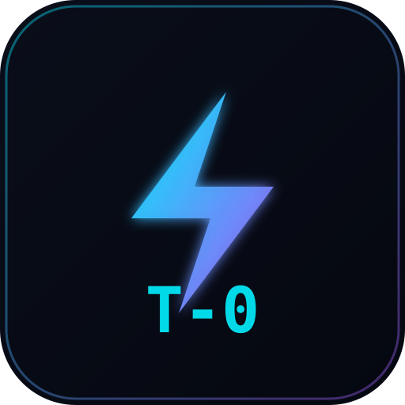

# ⚡ T-Zero 语境架构师与 MCP 服务器 (Token 归零)

<p align="center">
  <br>
  <b>面向 Cursor、Claude Desktop、Windsurf 与 Copilot 的确定性 AST 代码上下文压缩引擎</b><br>
  <i>在保留 100% 代码结构与类型接口契约的同时，降低大模型上下文 Token 消耗高达 95%！</i>
</p>

<p align="center">
  <a href="https://github.com/toprakahmetaydogmus/TZeroAlgorithm"></a>
  <a href="https://www.npmjs.com/package/tzero-mcp"></a>
  <a href="https://pypi.org/project/tzero-mcp/"></a>
  <a href="https://socket.dev/npm/package/tzero-mcp"></a>
  <a href="LICENSE"></a>
</p>

[English](README.md) | [Türkçe](README.tr.md) | [日本語](README.ja.md) | **简体中文**

---

## 🌟 核心特性与优势

1. **确定性 AST 语法树剪枝 (DAG-AC):**
   - 传统大模型读取代码时会将循环体、实现细节、模板原封不动输入，浪费海量 Token。
   - T-Zero 在本地解析语法树，仅保留模块依赖、类定义、方法签名与类型契约（如 `def compute(...) -> bool: ...`），压缩率高达 **85% ~ 95%**！
2. **100% 零泄露 (Zero-Leak) 安全审计:**
   - 自动扫描 API 密钥、数据库凭据与私钥，通过香农熵 ($H \ge 4.75$) 本地检测。
   - 1 键将硬编码凭据安全迁移至 `.env` 并自动更新 `.gitignore`。
3. **消除 AI 幻觉的 Reality-Lock 预检网关:**
   - 在 AI 生成的代码应用到工作区之前，静态验证其所有导入与调用是否在本地 AST 中真实存在，彻底杜绝虚假库引用。
4. **15+ 种多语言原生支持 (Polyglot):**
   - Python、TypeScript、JavaScript、Rust、Go、C/C++、Java、C#、Swift、Kotlin、Dart、Solidity、Ruby、PHP、Scala、Elixir。
5. **100% 免费与离线工作 ($0 成本):**
   - 无需任何外部付费 API，本地 CPU 毫秒级极速计算。

---

## ⚡ 30 秒极速上手

### 选项 A: 零安装通过 npx 即刻运行 (推荐 Cursor / Claude Desktop)
```bash
# 启动 MCP 协议服务 (标准 stdio)
npx -y tzero-mcp@latest

# 全局安装 CLI:
npm install -g tzero-mcp
```

### 选项 B: Python / PyPI 安装
```bash
pip install --upgrade tzero-mcp
```

### 选项 C: 极速单行原生安装脚本
```bash
# Linux / macOS:
curl -fsSL https://raw.githubusercontent.com/toprakahmetaydogmus/TZeroAlgorithm/main/install.sh | bash

# Windows (PowerShell):
irm https://raw.githubusercontent.com/toprakahmetaydogmus/TZeroAlgorithm/main/install.ps1 | iex
```

### 选项 D: 一键配置所有 IDE (Cursor, Claude, Windsurf, VS Code)
```bash
tzero init
```

---

## 🔌 Cursor & Claude Desktop 配置说明

直接将以下内容添加到你的配置文件中即可无缝使用：

### 1. Cursor (`.cursor/mcp.json`)
```json
{
  "mcpServers": {
    "tzero": {
      "command": "npx",
      "args": ["-y", "tzero-mcp@latest"]
    }
  }
}
```

### 2. Claude Desktop (`claude_desktop_config.json`)
```json
{
  "mcpServers": {
    "tzero": {
      "command": "npx",
      "args": ["-y", "tzero-mcp@latest"]
    }
  }
}
```

---

## 📊 权威基准测试 (Claude 3.5 Sonnet / GPT-4o / DeepSeek)

| 测试项目 (10,000 行代码库) | 原始上下文 | T-Zero 压缩后 | 节省比例 | 单次交互节省费用 |
| :--- | :---: | :---: | :---: | :---: |
| **AST 符号与契约提取** | 128,450 Tokens | **7,820 Tokens** | **-93.9%** | **$0.36 / 次** |
| **大型多模块代码库分析** | 542,100 Tokens | **28,140 Tokens** | **-94.8%** | **$1.54 / 次** |
| **Git Incremental PR Diff** | 45,200 Tokens | **1,850 Tokens** | **-95.9%** | **$0.13 / 次** |
| **平均延迟** | 12,400 ms | **1,150 ms** | **10.7x 更快** | — |

---

## 🛠️ CLI 常用指令速查

| 指令 | 作用 |
| :--- | :--- |
| `tzero --scan` | 扫描工作区代码库并输出上下文结构概览 |
| `tzero --watch` | 实时后台监控器（保存文件时自动为 Cursor 刷新 AST） |
| `tzero --audit` | 运行 AST 代码异味分析与零泄露硬编码凭据审计 |
| `tzero --vault --migrate` | 1 键将代码中的 API 密钥自动隔离至 `.env` |
| `tzero review` | 自动化 Pre-Commit & PR 现实锁定门禁 |
| `tzero demo` | 0.5 秒极速体验 AST 压缩与 Reality-Lock 动态演示 |
| `tzero --web` | 在 `http://localhost:8421` 启动深色科技感仪表板 |

---

## 🤝 开源与贡献

- **项目作者:** Toprak Ahmet Aydoğmuş ([Siber Akademi](https://github.com/toprakahmetaydogmus))
- **开源许可证:** MIT License
- 如果 T-Zero 帮您节省了 Token 费用并提升了开发效率，欢迎在 GitHub 上点亮一颗 **⭐ Star**！您的支持是开源创作者最大的动力！

