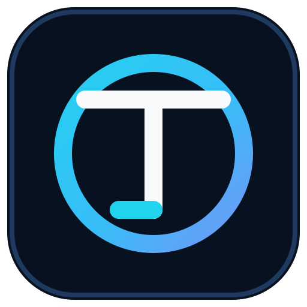

# T-Zero コンテキストアーキテクト & MCP サーバー (Token 削減エンジン)

<p align="center">
  <br>
  <b>Cursor、Claude Desktop、Windsurf、VS Code Copilot 対応の決定的 AST コード圧縮エンジン</b><br>
  <i>型定義とインターフェース契約を 100% 保持しながら、LLM コンテキストのトークン消費量を最大 95% 削減！</i>
</p>

<div align="center">

<!-- Badges Tier 1: Distribution, Release & Scale -->
[](https://github.com/toprakahmetaydogmus/TZeroAlgorithm/releases)
[](https://pypi.org/project/tzero-mcp/)
[](https://www.npmjs.com/package/tzero-mcp)
[](https://marketplace.visualstudio.com/items?itemName=siber-akademi.tzero-vscode)
[](https://open-vsx.org/extension/siber-akademi/tzero-vscode)
[](https://github.com/toprakahmetaydogmus/TZeroAlgorithm/releases)
[](https://github.com/toprakahmetaydogmus/TZeroAlgorithm/stargazers)

<!-- Badges Tier 2: Engineering Quality, Security, Tests & Governance -->
[](../README.md#whats-new-in-v1200-turbo-rust-hybrid-core--multi-language-tree-sitter)
[](../README.md#security-architecture)
[-10b981?style=flat-square&logo=githubactions&logoColor=white)](https://github.com/toprakahmetaydogmus/TZeroAlgorithm/actions/workflows/ci.yml)
[-8b5cf6?style=flat-square&logo=checkmarx&logoColor=white)](https://glama.ai/mcp/servers/toprakahmetaydogmus/TZeroAlgorithm/schema)
[](https://github.com/toprakahmetaydogmus/TZeroAlgorithm/actions/workflows/codeql.yml)
[](https://github.com/toprakahmetaydogmus/TZeroAlgorithm/blob/main/.github/dependabot.yml)
[](../LICENSE)

</div>

[English](../README.md) | [Türkçe](README.tr.md) | **日本語** | [简体中文](README.zh.md)

---

## 主な機能と特長

1. **決定的 AST 構文木プルーニング (DAG-AC):**
   - 従来のプロンプトでは関数の実装やループなどの余分なコードでトークン枠を浪費します。
   - T-Zero はローカルで構文木を解析し、クラス構造、関数シグネチャ、型契約のみ（例: `def compute(...) -> bool: ...`）を抽出。**85%〜95% のトークン削減**を実現します。
2. **100% ゼロリーク (Zero-Leak) セキュリティ監査:**
   - シャノンエントロピー ($H \ge 4.75$) 解析により、ハードコードされた API キーや機密情報をローカルで即座に検出。
   - 1 コマンドで安全に `.env` へ移行し、自動で `.gitignore` に追加します。
3. **AI ハルシネーション撲滅 (Reality-Lock):**
   - AI が提案したコードを適用する前に、実在しない架空のライブラリや関数の呼び出しを静的 AST で事前検証・排除します。
4. **15+ 言語ネイティブ対応 (Polyglot):**
   - Python、TypeScript、JavaScript、Rust、Go、C/C++、Java、C#、Swift、Kotlin、Dart、Solidity、Ruby、PHP、Scala、Elixir。
5. **完全ローカル & 永久無料 ($0 コスト):**
   - 有料 API や外部クラウド通信は一切不要。オフラインのミリ秒単位で高速動作します。

---

## 30 秒クイックスタート

### 選択肢 A: npx による即時起動（インストール不要・推奨）
```bash
# MCP サーバーを直接起動 (stdio)
npx -y tzero-mcp@latest

# グローバル CLI インストール:
npm install -g tzero-mcp
```

### 選択肢 B: Python / PyPI からのインストール
```bash
pip install --upgrade tzero-mcp
```

### 選択肢 C: ワンライナー高速インストーラー
```bash
# Linux / macOS:
curl -fsSL https://raw.githubusercontent.com/toprakahmetaydogmus/TZeroAlgorithm/main/install.sh | bash

# Windows (PowerShell):
irm https://raw.githubusercontent.com/toprakahmetaydogmus/TZeroAlgorithm/main/install.ps1 | iex
```

### 選択肢 D: 全 IDE (Cursor / Claude / Windsurf / VS Code) の一括自動設定
```bash
tzero init
```

---

## Cursor & Claude Desktop 設定方法

設定ファイルに以下を追記するだけで即座に連携可能です：

### 1. Cursor (`.cursor/mcp.json`)
```json
{
  "mcpServers": {
    "tzero": {
      "command": "npx",
      "args": ["-y", "tzero-mcp@latest"]
    }
  }
}
```

### 2. Claude Desktop (`claude_desktop_config.json`)
```json
{
  "mcpServers": {
    "tzero": {
      "command": "npx",
      "args": ["-y", "tzero-mcp@latest"]
    }
  }
}
```

---

## ベンチマーク検証 (Claude 3.5 Sonnet / GPT-4o / DeepSeek)

| 検証項目 (10,000 行コードベース) | 生のコード | T-Zero 圧縮後 | 削減率 | 1リクエストあたりの節約コスト |
| :--- | :---: | :---: | :---: | :---: |
| **AST 型シグネチャ抽出** | 128,450 Tokens | **7,820 Tokens** | **-93.9%** | **$0.36 / 回** |
| **大規模モジュール解析** | 542,100 Tokens | **28,140 Tokens** | **-94.8%** | **$1.54 / 回** |
| **Git Incremental PR Diff** | 45,200 Tokens | **1,850 Tokens** | **-95.9%** | **$0.13 / 回** |
| **レスポンス応答速度** | 12,400 ms | **1,150 ms** | **10.7倍 高速** | — |

---

## よく使う CLI コマンド

| コマンド | 説明 |
| :--- | :--- |
| `tzero --scan` | プロジェクト全体を走査し、AST コンテキストの概要を表示 |
| `tzero --watch` | ファイル保存時に自動で Cursor/Claude 向けコンテキストを再生成 |
| `tzero --audit` | 静的 AST コードスメルおよび機密情報漏洩を監査 |
| `tzero --vault --migrate` | ハードコードされた API キーを自動で `.env` へ移行 |
| `tzero review` | コミット前 / PR マージ前の自律的 Reality-Lock 検査 |
| `tzero demo` | 0.5 秒で AST 圧縮と Reality-Lock の動作を体験 |
| `tzero --web` | `http://localhost:8421` でダークモード開発者ダッシュボードを起動 |

---

## 開発者 & ライセンス

- **作者:** Toprak Ahmet Aydoğmuş ([Siber Akademi](https://github.com/toprakahmetaydogmus))
- **ライセンス:** AGPL-3.0-only
- T-Zero がお役に立ちましたら、ぜひ GitHub リポジトリへの **⭐ Star** をお願いいたします！

---

## オープンソースへの支援: T-Zero を永久に 100% 無料で維持

T-Zero は、ベンチャーキャピタルや有料サブスクリプション、テレメトリ追跡なしで開発されている完全ローカル＆完全無料（$0 クラウドコスト）のオープンソースプロジェクトです。開発の継続と CI/CD インフラ維持のため、ご支援をよろしくお願いいたします：

- ⭐ **リポジトリに Star を付ける:** オープンソースコミュニティでの認知度向上につながります。
- 🪙 **1-Click 暗号資産での寄付（ディープリンク対応）:**

| ネットワーク / 資産 | アドレス | 1-Click 送金リンク (Deep Link) | エクスプローラー / 詳細 |
| :--- | :--- | :--- | :--- |
| 🔷 **Ethereum / EVM**<br>*(ETH, ERC-20, Polygon, Arbitrum, BSC, Optimism)* | `0xF36Cd453f9F2bE91647C006C46ff66fB41d9F0c5` | [⚡ **Web3 ウォレットで送金 (EIP-681)**](ethereum:0xF36Cd453f9F2bE91647C006C46ff66fB41d9F0c5)<br>[🦊 **MetaMask で開く**](https://metamask.app.link/send/0xF36Cd453f9F2bE91647C006C46ff66fB41d9F0c5) | [🔍 Etherscan](https://etherscan.io/address/0xF36Cd453f9F2bE91647C006C46ff66fB41d9F0c5) |
| 🟠 **Bitcoin (BTC)**<br>*(Native SegWit bech32)* | `bc1q9k4hvd6c2g8l9w3z7v8f2k3j5l8n9m1p4q7r0s` | [⚡ **Bitcoin ウォレットで送金 (BIP-21)**](bitcoin:bc1q9k4hvd6c2g8l9w3z7v8f2k3j5l8n9m1p4q7r0s?label=T-Zero%20Sponsorship) | [🔍 Mempool Explorer](https://mempool.space/address/bc1q9k4hvd6c2g8l9w3z7v8f2k3j5l8n9m1p4q7r0s) |
| 🟢 **USDT (TRC-20)**<br>*(Tron Network)* | `TE7uKxZJ414u938gWf6bYh9QvRk2141517` | [⚡ **Tron ウォレットで送金**](tron:TE7uKxZJ414u938gWf6bYh9QvRk2141517) | [🔍 Tronscan](https://tronscan.org/#/address/TE7uKxZJ414u938gWf6bYh9QvRk2141517) |
| 💖 **GitHub Sponsors** | 開発者支援 | [💖 **GitHub でスポンサーになる**](https://github.com/sponsors/toprakahmetaydogmus) | 単発・定期支援 |
| 🌐 **クリエイターハブ** | Toprak Ahmet Aydoğmuş (Siber Akademi) | [🌐 **hopp.bio/siberegitim**](https://hopp.bio/siberegitim) | プロフィール・連絡先 |

<details>
<summary>📱 <b>1-Click QR コードを表示 (Ethereum, Bitcoin, Tron)</b></summary>
<br>

<div align="center">

| 🔷 Ethereum / EVM | 🟠 Bitcoin (BTC) | 🟢 USDT (TRC-20 Tron) |
| :---: | :---: | :---: |
| <br><br>[⚡ **送金 (EIP-681)**](ethereum:0xF36Cd453f9F2bE91647C006C46ff66fB41d9F0c5)<br>[🦊 **MetaMask**](https://metamask.app.link/send/0xF36Cd453f9F2bE91647C006C46ff66fB41d9F0c5) | <br><br>[⚡ **送金 (BIP-21)**](bitcoin:bc1q9k4hvd6c2g8l9w3z7v8f2k3j5l8n9m1p4q7r0s?label=T-Zero%20Sponsorship) | <br><br>[⚡ **Tron で送金**](tron:TE7uKxZJ414u938gWf6bYh9QvRk2141517) |
| `0xF36Cd453f9F2bE91647C006C46ff66fB41d9F0c5` | `bc1q9k4hvd6c2g8l9w3z7v8f2k3j5l8n9m1p4q7r0s` | `TE7uKxZJ414u938gWf6bYh9QvRk2141517` |

</div>

</details>

---

## スター推移 (Star History)

<div align="center">
  <a href="https://star-history.com/#toprakahmetaydogmus/TZeroAlgorithm&Date">
    
  </a>
</div>

