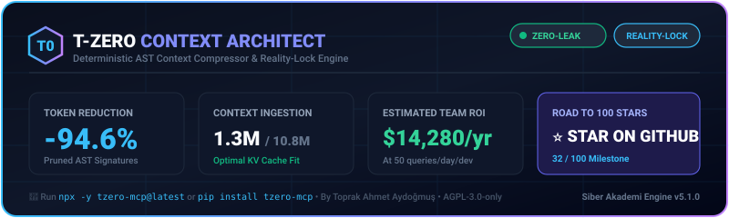

# T-Zero Algoritması - Türkçe Dokümantasyon

[English](../README.md) | **[Türkçe](README.tr.md)** | [日本語](README.ja.md) | [简体中文](README.zh.md) | [Gizlilik Politikası (Privacy)](../PRIVACY.md) | [Google Colab Canlı Lab](https://colab.research.google.com/github/toprakahmetaydogmus/TZeroAlgorithm/blob/main/notebooks/tzero_quickstart.ipynb) | [Hugging Face Canlı Demo](https://huggingface.co/spaces/toprakke4/tzero-token-reducer) | [Tarayıcıda Doğrudan Aç (GitHub Codespaces)](https://codespaces.new/toprakahmetaydogmus/TZeroAlgorithm)

<div align="center">

[](https://github.com/toprakahmetaydogmus/TZeroAlgorithm)
[](https://m8ven.ai/mcp/toprakahmetaydogmus/tzeroalgorithm?s=readme)
[](https://findfreeapi.com/en/service/tzeroalgorithm)
[](https://pypi.org/project/tzero-mcp/)
[](https://pypi.org/project/tzero-mcp/)
[](https://pypi.org/project/tzero-mcp/)
[](https://www.npmjs.com/package/tzero-mcp)
[](https://www.npmjs.com/package/tzero-mcp)
[](https://www.npmjs.com/package/tzero-mcp)
[](https://marketplace.visualstudio.com/items?itemName=siber-akademi.tzero-vscode)
[](https://open-vsx.org/extension/siber-akademi/tzero-vscode)

<br>

<p align="center">
  <a href="https://github.com/toprakahmetaydogmus/TZeroAlgorithm">
    
  </a>
</p>

<div align="center">

### 🌟 100 Yıldız Yolculuğu: T-Zero'nun 100 Yıldız Hedefine Ulaşmasına Destek Olun!
[](https://github.com/toprakahmetaydogmus/TZeroAlgorithm)
[-10b981?style=for-the-badge&logo=opensourceinitiative&logoColor=white)](../LICENSE)
[](https://linkedin.com/in/toprak-ahmet-aydo%C4%9Fmu%C5%9F-60462534b/)

> **T-Zero LLM bağlam boyutunuzu küçülttüyse veya token faturalarınızı düşürdüyse lütfen GitHub'da bize bir yıldız verin! ⭐**  
> *Her bir yıldız, bağımsız geliştiricinin bu projeyi %100 ücretsiz, çevrimdışı ve sıfır sızıntılı olarak sürdürmesini destekler.*

</div>

</div>

---

<a id="turkce"></a>
## 🇹🇷 Türkçe Dokümantasyon

T-Zero (Token Zero), yapay zeka kodlama asistanları (Cursor, Claude Desktop, Antigravity IDE, Windsurf, Cline, VS Code, Zed) için geliştirilmiş, **deterministik AST bağlam sıkıştırıcısı ve Model Context Protocol (MCP) sunucusudur**.

### Neden T-Zero?
Yapay zeka modellerine tüm kaynak kodlar metin olarak verildiğinde, fonksiyon gövdelerindeki döngüler ve ara hesaplamalar yüzünden **bağlam penceresinin %80 ila %95'i israf edilir**. T-Zero, kodu metin olarak değil AST (Soyut Sözdizimi Ağacı) olarak okur; fonksiyon gövdelerini çıkarıp arayüzleri, tipleri ve sınıf yapılarını korur.

### Temel Özellikler:
- **20 Standart MCP Aracı:** `get_project_context_tree`, `prune_code_snippet`, `audit_codebase_quality`, `verify_hallucination_guard`, `auto_vault_migrate`, `change_impact_analysis` vb.
- **Smart Skeleton (Tier-2):** Üzerinde çalışılan hedef dosya %100 tam kod kalırken, çevresindeki 1. derece bağımlılıklar imza iskeleti haline getirilir.
- **Reality-Lock Halüsinasyon Kontrolü & %0 Kaçış İspatı:** Modelin uydurduğu import ve fonksiyon çağrılarını koda yazılmadan önce statik AST üzerinde yakalar, 60 ampirik senaryo ile %0.0 halüsinasyon kaçış oranını kanıtlar ve kendi kendine onarır (`tzero --prove-zero-hallucination`).
- **1-Tıkla Auto-Vault Sızıntı Taşıyıcı:** Koddaki gizli API anahtarlarını otomatik bulup `.env` içine taşır, `.gitignore`'a ekler ve kodu `os.environ.get(...)` ile refactor eder.
- **Shannon Entropi Güvenlik Filtresi:** Yüksek entropili ($H \ge 4.75$) gizli anahtarları ve şifreleri yerel olarak tespit eder.
- **Turbo Overdrive (Kamçılama Modu):** Kod tarama veya AST çıkarımı yavaşladığında (>150ms veya $\ge 15$ dosya) otomatik devreye girerek 32 worker thread ile paralel burst ve mikrosaniye seviyesinde bellek içi fast-path önbellek sunar.
- **Otonom Dinamik Alt Ajan Fabrikası (Dynamic Subagent Swarm):** Karmaşık görev verildiğinde aynı anda gereken tüm alt görevleri analiz eder; gerekirse anında ad-hoc alt ajanlar sentezleyip (`AgentForge`) çok çekirdekli paralel koşturur ve PBFT konsensüsü ile birleştirir.
- **%100 Yerel ve Çevrimdışı:** Dış bulut embedding API'si gerektirmez, $0 maliyetle çalışır.
- **Sıfır-Halüsinasyon Matematiksel & Ampirik İspat Raporu:** [ZERO_HALLUCINATION_PROOF.md](ZERO_HALLUCINATION_PROOF.md)
- **Google Colab İnteraktif Lab:** [Google Colab Üzerinde Test Et](https://colab.research.google.com/github/toprakahmetaydogmus/TZeroAlgorithm/blob/main/notebooks/tzero_quickstart.ipynb)
- **Bilimsel ve Teknik Whitepaper:** [WHITE_PAPER_TZERO_V10.md](WHITE_PAPER_TZERO_V10.md) (Matematiksel ispatlar, DAG-AC sıkıştırma ve Reality-Lock analizi)
- **Hugging Face Canlı Demo:** [https://huggingface.co/spaces/toprakke4/tzero-token-reducer](https://huggingface.co/spaces/toprakke4/tzero-token-reducer)

### ⚡ 30 Saniyede Hızlı Kurulum

```bash
# 📦 Seçenek A: Node.js / npx ile Anında Çalıştırma (Sıfır Kurulum):
# Cursor, Claude Desktop, Antigravity, Copilot için:
npx -y tzero-mcp@latest

# Global NPM CLI Kurulumu:
npm install -g tzero-mcp

# 🐍 Seçenek B: Python pip ile Kurulum:
pip install --upgrade tzero-mcp

# 🌟 Seçenek C: Tek Satır Otomatik Yükleyici:
# Linux / macOS: curl -fsSL https://raw.githubusercontent.com/toprakahmetaydogmus/TZeroAlgorithm/main/install.sh | bash
# Windows:       irm https://raw.githubusercontent.com/toprakahmetaydogmus/TZeroAlgorithm/main/install.ps1 | iex

# 🐙 Seçenek D: Git Clone ile Doğrudan Kaynak Koddan Çalışma:
git clone https://github.com/toprakahmetaydogmus/TZeroAlgorithm.git
cd TZeroAlgorithm
python scripts/welcome.py    # Hoş geldin & otomatik git hook yıldız hatırlatıcı
pip install -e .             # Geliştirici modu (.githooks otomatik aktifleşir)

# 🚀 Tek Tıkla IDE'leri (Cursor, Claude, Windsurf, VS Code) Bağla:
tzero init

# 📢 Tek Tıkla Topluluk Paylaşım Merkezi (Twitter, Reddit, Hacker News):
tzero share

# 🧩 VS Code / Cursor Eklentisini (.vsix) Yükle:
code --install-extension dist/tzero-vscode-12.1.0.vsix

# ⚡ Yerel CI ve Pre-Push Korumasını Çalıştır ($0 Kota):
tzero local-ci --quick

# 🛡️ Otomatik Git Pre-Push Hook Kur (Hatalı push'ları engeller):
tzero local-ci --install-hook
```

---

## ⚡ T-Zero Local CI: Sıfır Kota Tüketimiyle Yerel Doğrulama

GitHub Actions dakikalarını yakıp uzakta hata beklemenin önüne geçin! **T-Zero Local CI**, uzaktaki tüm testleri yerel makinenizde **<10 saniyede** çalıştırır:

- **7 Kademe Doğrulama:** Metadata Senkronizasyonu, %100 Sıfır-Sızıntı Güvenlik Taraması, AST ve T-4 Mimari Sınırları, flake8 Linter, Unit Testler, Node.js Eklenti Testleri ve M8ven MCP Uyumluluğu.
- **Otomatik Git Kalkanı (`--install-hook`):** `git push` yaptığınızda yerel CI otomatik devreye girer. Tek bir hata varsa push durdurulur ve GitHub Actions kotanızdan **0 saniye** harcanır!
- **Bağımsız Binary:** `dist/TZeroCI.exe` ile Python kurulumuna bile gerek kalmadan çalıştırabilirsiniz.


---

## ⭐ Açık Kaynak İnovasyonu Destekleyin!

Merhaba! Ben **Toprak Ahmet Aydoğmuş**, Siber Akademi'den. T-Zero'yu sıfırdan, yapay zeka kodlama araçlarındaki token israfını ve halüsinasyonları çözmek için %100 yerel ve ücretsiz ($0 maliyet) olarak geliştirdim.

Eğer T-Zero işinize yaradıysa lütfen GitHub üzerinden bir ⭐ vermeyi unutmayın! Her yıldız açık kaynak ekosistemini güçlendirir. 🚀

<div align="center">

### 📊 Canlı Ekosistem ve Dağıtım İstatistikleri
*(GitHub API, npm Registry ve PyPI PePy üzerinden 7/24 anlık otomatik güncellenir)*

[](https://github.com/toprakahmetaydogmus/TZeroAlgorithm/stargazers)
[](https://github.com/toprakahmetaydogmus/TZeroAlgorithm/network/members)
[](https://www.npmjs.com/package/tzero-mcp)
[](https://www.npmjs.com/package/tzero-mcp)
[](https://pypi.org/project/tzero-mcp/)
[](https://pypi.org/project/tzero-mcp/)
[](https://open-vsx.org/extension/siber-akademi/tzero-vscode)
[](https://github.com/toprakahmetaydogmus/TZeroAlgorithm/commits/main)

<br>

### 🚀 Tek Tıkla Topluluk Paylaşımı
**100 Yıldız Hedefimize** ulaşmamıza destek olun! T-Zero'yu tek tıkla paylaşın:

[](https://twitter.com/intent/tweet?text=T-Zero%3A%20Yapay%20zeka%20kodlama%20ara%C3%A7lar%C4%B1nda%20token%20israf%C4%B1n%C4%B1%20%2595%20azaltan%20yerel%20AST%20ba%C4%9Flam%20motoru.%20Geli%C5%9Ftirici%3A%20Toprak%20Ahmet%20Aydo%C4%9Fmu%C5%9F%20(Siber%20Akademi).&url=https%3A%2F%2Fgithub.com%2Ftoprakahmetaydogmus%2FTZeroAlgorithm&hashtags=CursorAI,ClaudeAI,MCP,OpenSource)
[](https://www.reddit.com/submit?url=https%3A%2F%2Fgithub.com%2Ftoprakahmetaydogmus%2FTZeroAlgorithm&title=T-Zero%20%E2%80%94%20Deterministik%20AST%20Ba%C4%9Flam%20S%C4%B1k%C4%B1%C5%9Ft%C4%B1r%C4%B1c%C4%B1s%C4%B1%20ve%20MCP%20Sunucusu)
[](https://www.linkedin.com/sharing/share-offsite/?url=https%3A%2F%2Fgithub.com%2Ftoprakahmetaydogmus%2FTZeroAlgorithm)
[](https://api.whatsapp.com/send?text=T-Zero%20ba%C4%9Flam%20motoruna%20g%C3%B6z%20at%3A%20https%3A%2F%2Fgithub.com%2Ftoprakahmetaydogmus%2FTZeroAlgorithm)
[](https://github.com/toprakahmetaydogmus/TZeroAlgorithm)

<br>

**T-Zero Sonsuza Kadar %100 Ücretsiz, Açık Kaynak ve Çevrimdışıdır.**  
*Toprak Ahmet Aydoğmuş (Siber Akademi) tarafından dünya genelindeki tüm geliştiriciler için sevgiyle geliştirildi.*

</div>

---

## 📈 Yıldız Geçmişi (Star History)

<div align="center">

<a href="https://star-history.com/#toprakahmetaydogmus/TZeroAlgorithm&Date">
  
</a>

</div>

---
[Ana Dokümantasyona Dön (English)](README.md)

## Lisans

T-Zero, [GNU AGPL-3.0-only](../LICENSE) ile lisanslanır. [Telif bildirimi, yazar atfı ve 7. bölüm koşulları](../NOTICE).
