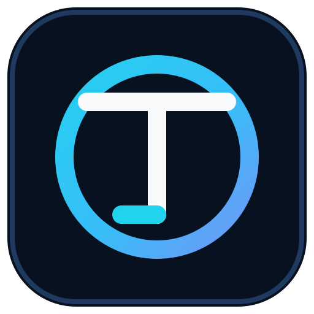

# T-Zero 语境架构师与 MCP 服务器 (Token 归零)

<p align="center">
  <br>
  <b>面向 Cursor、Claude Desktop、Windsurf 与 Copilot 的确定性 AST 代码上下文压缩引擎</b><br>
  <i>在保留 100% 代码结构与类型接口契约的同时，降低大模型上下文 Token 消耗高达 95%！</i>
</p>

<div align="center">

<!-- Badges Tier 1: Distribution, Release & Scale -->
[](https://github.com/toprakahmetaydogmus/TZeroAlgorithm/releases)
[](https://pypi.org/project/tzero-mcp/)
[](https://www.npmjs.com/package/tzero-mcp)
[](https://marketplace.visualstudio.com/items?itemName=siber-akademi.tzero-vscode)
[](https://open-vsx.org/extension/siber-akademi/tzero-vscode)
[](https://github.com/toprakahmetaydogmus/TZeroAlgorithm/releases)
[](https://github.com/toprakahmetaydogmus/TZeroAlgorithm/stargazers)

<!-- Badges Tier 2: Engineering Quality, Security, Tests & Governance -->
[](../README.md#whats-new-in-v1200-turbo-rust-hybrid-core--multi-language-tree-sitter)
[](../README.md#security-architecture)
[-10b981?style=flat-square&logo=githubactions&logoColor=white)](https://github.com/toprakahmetaydogmus/TZeroAlgorithm/actions/workflows/ci.yml)
[-8b5cf6?style=flat-square&logo=checkmarx&logoColor=white)](https://glama.ai/mcp/servers/toprakahmetaydogmus/TZeroAlgorithm/schema)
[](https://github.com/toprakahmetaydogmus/TZeroAlgorithm/actions/workflows/codeql.yml)
[](https://github.com/toprakahmetaydogmus/TZeroAlgorithm/blob/main/.github/dependabot.yml)
[](../LICENSE)

</div>

[English](../README.md) | [Türkçe](README.tr.md) | [日本語](README.ja.md) | **简体中文**

---

## 核心特性与优势

1. **确定性 AST 语法树剪枝 (DAG-AC):**
   - 传统大模型读取代码时会将循环体、实现细节、模板原封不动输入，浪费海量 Token。
   - T-Zero 在本地解析语法树，仅保留模块依赖、类定义、方法签名与类型契约（如 `def compute(...) -> bool: ...`），压缩率高达 **85% ~ 95%**！
2. **100% 零泄露 (Zero-Leak) 安全审计:**
   - 自动扫描 API 密钥、数据库凭据与私钥，通过香农熵 ($H \ge 4.75$) 本地检测。
   - 1 键将硬编码凭据安全迁移至 `.env` 并自动更新 `.gitignore`。
3. **消除 AI 幻觉的 Reality-Lock 预检网关:**
   - 在 AI 生成的代码应用到工作区之前，静态验证其所有导入与调用是否在本地 AST 中真实存在，彻底杜绝虚假库引用。
4. **15+ 种多语言原生支持 (Polyglot):**
   - Python、TypeScript、JavaScript、Rust、Go、C/C++、Java、C#、Swift、Kotlin、Dart、Solidity、Ruby、PHP、Scala、Elixir。
5. **100% 免费与离线工作 ($0 成本):**
   - 无需任何外部付费 API，本地 CPU 毫秒级极速计算。

---

## 30 秒极速上手

### 选项 A: 零安装通过 npx 即刻运行 (推荐 Cursor / Claude Desktop)
```bash
# 启动 MCP 协议服务 (标准 stdio)
npx -y tzero-mcp@latest

# 全局安装 CLI:
npm install -g tzero-mcp
```

### 选项 B: Python / PyPI 安装
```bash
pip install --upgrade tzero-mcp
```

### 选项 C: 极速单行原生安装脚本
```bash
# Linux / macOS:
curl -fsSL https://raw.githubusercontent.com/toprakahmetaydogmus/TZeroAlgorithm/main/install.sh | bash

# Windows (PowerShell):
irm https://raw.githubusercontent.com/toprakahmetaydogmus/TZeroAlgorithm/main/install.ps1 | iex
```

### 选项 D: 一键配置所有 IDE (Cursor, Claude, Windsurf, VS Code)
```bash
tzero init
```

---

## Cursor & Claude Desktop 配置说明

直接将以下内容添加到你的配置文件中即可无缝使用：

### 1. Cursor (`.cursor/mcp.json`)
```json
{
  "mcpServers": {
    "tzero": {
      "command": "npx",
      "args": ["-y", "tzero-mcp@latest"]
    }
  }
}
```

### 2. Claude Desktop (`claude_desktop_config.json`)
```json
{
  "mcpServers": {
    "tzero": {
      "command": "npx",
      "args": ["-y", "tzero-mcp@latest"]
    }
  }
}
```

---

## 同一模型的对照测试

使用 Nemotron 3.5 Lightning 对六道题进行了成对测试。输入从 2,345 降为 1,772 个 token（减少 24.4%）。接口题两组均为 3/3，涉及实现细节的题目在完整代码组为 3/3，在摘要组为 0/3。[测试方法与结果](../README.md#task-completion-benchmark)

---

## CLI 常用指令速查

| 指令 | 作用 |
| :--- | :--- |
| `tzero --scan` | 扫描工作区代码库并输出上下文结构概览 |
| `tzero --watch` | 实时后台监控器（保存文件时自动为 Cursor 刷新 AST） |
| `tzero --audit` | 运行 AST 代码异味分析与零泄露硬编码凭据审计 |
| `tzero --vault --migrate` | 1 键将代码中的 API 密钥自动隔离至 `.env` |
| `tzero review` | 自动化 Pre-Commit & PR 现实锁定门禁 |
| `tzero demo` | 0.5 秒极速体验 AST 压缩与 Reality-Lock 动态演示 |
| `tzero --web` | 在 `http://localhost:8421` 启动深色科技感仪表板 |

---

## 开源与贡献

- **项目作者:** Toprak Ahmet Aydoğmuş ([Siber Akademi](https://github.com/toprakahmetaydogmus))
- **开源许可证:** AGPL-3.0-only
- 如果 T-Zero 帮您节省了 Token 费用并提升了开发效率，欢迎在 GitHub 上点亮一颗 **⭐ Star**！您的支持是开源创作者最大的动力！

---

## 支持开源创新: 让 T-Zero 永久 100% 免费

T-Zero 是一个由独立开发者构建、完全本地、离线且零泄露（$0 云端成本）的开源项目，无任何风险投资或付费订阅。如果 T-Zero 在日常 Cursor、Claude Code 或 Windsurf 工作流中帮您节省了 Token 费用，欢迎赞助支持以维持 CI/CD 构建基础设施：

- ⭐ **在 GitHub 点亮 Star:** 让更多开源开发者发现 T-Zero。
- 🪙 **1-Click 加密货币赞助（支持钱包深层链接）:**

| 网络 / 资产 | 钱包地址 | 1-Click 转账链接 (Deep Link) | 区块浏览器 / 详情 |
| :--- | :--- | :--- | :--- |
| 🔷 **Ethereum / EVM**<br>*(ETH, ERC-20, Polygon, Arbitrum, BSC, Optimism)* | `0xF36Cd453f9F2bE91647C006C46ff66fB41d9F0c5` | [⚡ **Web3 钱包转账 (EIP-681)**](ethereum:0xF36Cd453f9F2bE91647C006C46ff66fB41d9F0c5) | [🔍 Etherscan](https://etherscan.io/address/0xF36Cd453f9F2bE91647C006C46ff66fB41d9F0c5) |
| 🟠 **Bitcoin (BTC)**<br>*(Native SegWit bech32)* | `bc1q9k4hvd6c2g8l9w3z7v8f2k3j5l8n9m1p4q7r0s` | [⚡ **Bitcoin 钱包转账 (BIP-21)**](bitcoin:bc1q9k4hvd6c2g8l9w3z7v8f2k3j5l8n9m1p4q7r0s?label=T-Zero%20Sponsorship) | [🔍 Mempool 浏览器](https://mempool.space/address/bc1q9k4hvd6c2g8l9w3z7v8f2k3j5l8n9m1p4q7r0s) |
| 🟢 **USDT (TRC-20)**<br>*(Tron Network)* | `TE7uKxZJ414u938gWf6bYh9QvRk2141517` | [⚡ **Tron 钱包转账**](tron:TE7uKxZJ414u938gWf6bYh9QvRk2141517) | [🔍 Tronscan](https://tronscan.org/#/address/TE7uKxZJ414u938gWf6bYh9QvRk2141517) |
| 💖 **GitHub Sponsors** | 开发者赞助 | [💖 **在 GitHub 上赞助**](https://github.com/sponsors/toprakahmetaydogmus) | 单次或按月支持 |
| 🌐 **创作者主页** | Toprak Ahmet Aydoğmuş (Siber Akademi) | [🌐 **hopp.bio/siberegitim**](https://hopp.bio/siberegitim) | 开发者主页与社交网络 |

<details>
<summary>📱 <b>点击查看 1-Click 二维码 (Ethereum, Bitcoin, Tron)</b></summary>
<br>

<div align="center">

| 🔷 Ethereum / EVM | 🟠 Bitcoin (BTC) | 🟢 USDT (TRC-20 Tron) |
| :---: | :---: | :---: |
| <br><br>[⚡ **转账 (EIP-681)**](ethereum:0xF36Cd453f9F2bE91647C006C46ff66fB41d9F0c5) | <br><br>[⚡ **转账 (BIP-21)**](bitcoin:bc1q9k4hvd6c2g8l9w3z7v8f2k3j5l8n9m1p4q7r0s?label=T-Zero%20Sponsorship) | <br><br>[⚡ **Tron 转账**](tron:TE7uKxZJ414u938gWf6bYh9QvRk2141517) |
| `0xF36Cd453f9F2bE91647C006C46ff66fB41d9F0c5` | `bc1q9k4hvd6c2g8l9w3z7v8f2k3j5l8n9m1p4q7r0s` | `TE7uKxZJ414u938gWf6bYh9QvRk2141517` |

</div>

</details>

---

## Star History

<div align="center">
  <a href="https://star-history.com/#toprakahmetaydogmus/TZeroAlgorithm&Date">
    
  </a>
</div>
