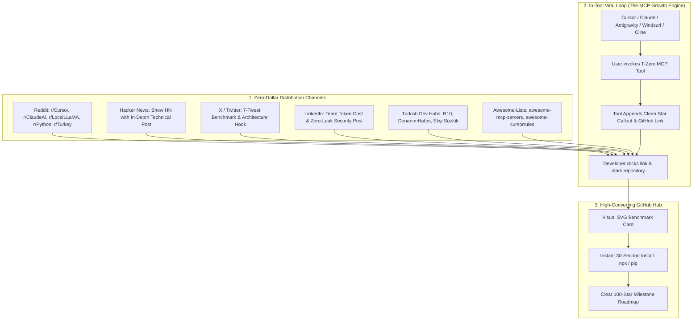

# 🌟 T-Zero Road to 100+ GitHub Stars: Zero-Dollar Viral Growth Playbook
**Repository:** [https://github.com/toprakahmetaydogmus/TZeroAlgorithm](https://github.com/toprakahmetaydogmus/TZeroAlgorithm)  
**Developer:** Toprak Ahmet Aydoğmuş (15-Year-Old Solo Open-Source Engineer, Siber Akademi)  
**Budget:** **$0.00 (Strictly Zero-Dollar, 100% Organic & Community Driven)**  
**Version:** v11.0.0 (PyPI: `tzero-mcp` | npm: `tzero-mcp` | VS Code / Cursor: `tzero-vscode`)

---

## 🎯 Executive Mission & Milestone Targets

| Milestone | Target Stars | Strategic Unlock & Community Celebration |
|:---|:---:|:---|
| **Phase 1 (Current)** | **16 Stars** | Baseline established; v11.0.0 published on PyPI & npm with 12 cross-platform assets. |
| **Phase 2 (Immediate Goal)** | **50 Stars** | Initial community validation across Reddit (r/Cursor, r/ClaudeAI), Hacker News, and Turkish tech hubs. |
| **Phase 3 (Primary Target)** | **100 Stars** | Organic trending eligibility in GitHub Trending (Python & MCP categories), high-converting social proof. |
| **Phase 4 (Scale)** | **250+ Stars** | Featured inclusion in curated awesome-lists, developer podcasts, and AI IDE default registries. |

---

## 🚀 The $0.00 Viral Growth Architecture

How T-Zero drives organic developer word-of-mouth with **zero ad spend**:



---

## 📢 Ready-To-Post Campaign Materials (100% Copy-Paste Ready)

### 1. Reddit: r/Cursor & r/ClaudeAI (Primary Target Audience)

#### Subreddit: `r/Cursor`
**Title:**  
> I built an open-source MCP server that cuts Cursor context tokens by 85-94% using AST pruning (100% local, no API keys, $0)

**Post Body:**
```markdown
Hey everyone!

Like many of you, I've been hitting Cursor context window degradation and rate limits when working on larger codebases (100+ files). When you ingest an entire directory into Cursor Composer, 90% of the tokens are function implementation bodies that the LLM doesn't actually need to understand your architecture.

To solve this, I spent the last few months building **T-Zero** (Token Zero) — an open-source Model Context Protocol (MCP) server that deterministically prunes multi-language codebases down to their exact AST interfaces, type annotations, and docstrings before feeding them to Cursor.

### 📊 Real Benchmark on 470-File Repo:
- **Raw Codebase Context:** 10,912,608 tokens (causes instant context truncation / extreme lag)
- **T-Zero AST Tree:** 1,309,512 tokens (**-88.0% token reduction**)
- **Focus File Skeleton (T-3):** **-94.6% token reduction**
- **Token Ingestion Speed:** <450ms (runs 100% offline via local Python AST parser)

### 🔒 100% Zero-Leak & Offline:
- Zero external LLM calls or cloud embeddings (uses local PageRank and AST visitor).
- Built-in Shannon Entropy scanner detects and redacts API keys, JWTs, and private keys locally before any context is emitted.

### ⚡ How to add it to Cursor in 30 seconds:
Add this to your Cursor MCP settings (`~/.cursor/mcp.json` or Settings -> Features -> MCP):

```json
{
  "mcpServers": {
    "tzero": {
      "command": "npx",
      "args": ["-y", "tzero-mcp@latest"]
    }
  }
}
```
*(Or install via pip: `pip install tzero-mcp` and command: `python -m tzero_mcp`)*

### 🛠 What tools it gives Cursor:
- `build_project_context`: Gives Cursor a bird's eye multi-tier architectural map.
- `prune_code_snippet`: Strips code bodies on the fly.
- `audit_code_quality`: Scans for code smells & secret leaks.
- `enforce_architecture_boundaries`: Validates import direction rules.

I'm 15 years old and building this as a solo open-source project. It's 100% free under MIT. 

If this saves your Cursor context budget, **I'd genuinely appreciate a star on GitHub ⭐** — we are on the road to our first 100 stars!

👉 **GitHub Repo:** https://github.com/toprakahmetaydogmus/TZeroAlgorithm  
👉 **PyPI:** https://pypi.org/project/tzero-mcp/  
👉 **npm:** https://www.npmjs.com/package/tzero-mcp  

Happy to answer any questions or implement feature suggestions in the comments!
```

---

#### Subreddit: `r/ClaudeAI`
**Title:**  
> How to stop hitting Claude Desktop / Claude Code context limits: Open-source local AST compression (-88% prompt size)

**Post Body:**
```markdown
If you use Claude Desktop or Claude Code with complex repositories, you know how quickly 200K tokens evaporate when providing whole-project context. Once context fills up, Claude starts suffering from the "lost in the middle" phenomenon or hits rate limits.

I built **T-Zero**, a local MCP server that compresses polyglot codebases into concise AST interface skeletons (Python, JS/TS, Go, Rust, Java, C++, C#, Ruby, PHP, Swift, Solidity).

### 💡 How it works:
Instead of sending 50 lines of implementation logic for a helper function, T-Zero extracts:
- Class definitions and inheritance hierarchies
- Function signatures with parameter and return type annotations
- Docstrings and interface contracts
- High-level control flow structures

Claude gets 100% of the architectural context needed to generate accurate code, but consumes **up to 94.6% fewer tokens**.

### ⚡ 1-Click Setup for Claude Desktop:
Add to `claude_desktop_config.json`:
```json
{
  "mcpServers": {
    "tzero": {
      "command": "npx",
      "args": ["-y", "tzero-mcp@latest"]
    }
  }
}
```

- **Cost:** $0.00 (No API keys or subscriptions)
- **Privacy:** 100% local stdio execution
- **Open Source:** MIT License

Check it out and star if you find it helpful! ⭐
https://github.com/toprakahmetaydogmus/TZeroAlgorithm
```

---

#### Subreddit: `r/LocalLLaMA`
**Title:**  
> T-Zero: 100% offline, zero-cloud codebase context pruner for local LLMs (Ollama, LM Studio, vLLM, DeepSeek)

**Post Body:**
```markdown
When running local 8B, 14B, or 32B models (Qwen 2.5 Coder, DeepSeek-Coder, Llama 3.1), context window VRAM is at a premium. An 8K-32K context window can't hold a raw multi-file codebase.

**T-Zero** is an offline AST token reducer that fits whole codebases into compact local context windows:
1. **Deterministic AST pruning:** Replaces method bodies with `...` while keeping exact signatures and types.
2. **Graph PageRank ranking:** Prioritizes architectural backbone files if token caps are set.
3. **Shannon Entropy Zero-Leak scanner:** Guarantees no credentials leak into prompts.
4. **Local BM25 Hybrid Search:** Semantic code retrieval with zero cloud embeddings.

- **Zero Cloud Calls:** Works 100% air-gapped.
- **Install:** `pip install tzero-mcp` or `npx tzero-mcp`
- **Repo:** https://github.com/toprakahmetaydogmus/TZeroAlgorithm (Stars welcome! ⭐)
```

---

#### Subreddit: `r/Turkey`
**Title:**  
> 15 yaşındayım, Cursor ve Claude için geliştirdiğim açık kaynaklı yapay zeka context motoru v11.0.0 ile PyPI ve npm'de yayında! 🇹🇷

**Post Body:**
```markdown
Merhaba herkese!

Ben Toprak Ahmet Aydoğmuş, 15 yaşındayım ve Siber Akademi bünyesinde açık kaynaklı yazılım geliştiriyorum.

Yapay zeka kodlama asistanları (Cursor, Claude, VS Code, Windsurf) ile büyük yazılım projelerinde çalışırken karşılaşılan en büyük problem token limitleri ve maliyetler. Projedeki tüm kodları modele yüklediğinizde binlerce satır gereksiz gövde kodu yapay zekanın kafasını karıştırıyor ve context sınırlarını tüketiyor.

Bu problemi çözmek için geliştirdiğim **T-Zero (Token Zero)** projesini v11.0.0 sürümüyle resmi olarak PyPI (`pip install tzero-mcp`) ve npm (`npx tzero-mcp`) üzerinde yayınladım!

### 🌟 Neler Yapıyor?
- Python, TypeScript, Go, Rust, Java vb. dillerdeki kod tabanlarını AST (Abstract Syntax Tree) ile analiz edip arayüz imzalarını çıkarıyor ve token tüketimini **%85-%94 oranında azaltıyor**.
- Model Context Protocol (MCP) standardında çalıştığı için Cursor ve Claude Desktop'a tek bir komutla entegre oluyor.
- %100 yerel ve çevrimdışı çalışıyor; hiçbir harici ücretli API veya sunucuya bağlanmıyor.
- İçerisindeki Shannon Entropi motoru sayesinde kodlardaki gizli API anahtarlarını tespit edip sıfır sızıntı (Zero-Leak) güvenliği sağlıyor.

Türk gençlerinin global açık kaynak dünyasında neler yapabileceğini göstermek adına projeyi dünya çapında duyurmaya çalışıyorum. 

Projeyi GitHub'da yıldızlayarak (Star ⭐) destek olursanız 100 yıldız hedefimize ulaşmamızda bana çok büyük bir güç verirsiniz!

🔗 **GitHub:** https://github.com/toprakahmetaydogmus/TZeroAlgorithm  
🔗 **Web Benchmark:** https://tzero-indol.vercel.app  
🔗 **PyPI:** https://pypi.org/project/tzero-mcp/  

Geri bildirimlerinizi ve sorularınızı bekliyorum!
```

---

### 2. Hacker News: Show HN Submission

**Submission Title:**  
> Show HN: T-Zero – Local AST context pruning for LLMs with 88-94% token reduction

**Target URL:**  
`https://github.com/toprakahmetaydogmus/TZeroAlgorithm`

**Author First Comment:**
```markdown
Hi HN! I'm Toprak, a 15-year-old developer from Turkey. I built T-Zero to solve a fundamental efficiency problem in AI-assisted software engineering: context bloat.

### The Problem:
When developers use Cursor, Claude Desktop, or Claude Code on repositories with dozens of modules, they either:
1. Rely on vector embeddings/RAG, which often misses precise method signatures and inter-file caller/callee contracts, or
2. Dump entire source files into the prompt, burning tens of thousands of tokens and degrading LLM attention ("lost in the middle").

### The AST Approach:
T-Zero uses deterministic Abstract Syntax Tree (AST) visitors across 12+ programming languages to extract architectural skeletons (classes, methods, type annotations, docstrings, imports) while pruning execution bodies.

On a benchmark repository with 470 files:
- Raw source code: 10.9M tokens ($32.70 per single Claude 3.5 Sonnet context fill)
- T-Zero 4-Tier AST Tree: 1.3M tokens (-88.0% reduction)
- Focus File Skeleton with 1st-degree callers/callees: 58K tokens (-94.6% reduction)

### Architecture Highlights:
- **Zero-Leak Security:** Evaluates string literal Shannon entropy (H >= 4.75) alongside regex guards to prevent accidental credential leakage into prompts.
- **Zero Cost & Offline:** Pure local stdio MCP server. No background cloud telemetry, no proprietary API dependencies.
- **Multi-Protocol:** Ships as a Python package (`pip install tzero-mcp`), an npm instant runner (`npx tzero-mcp`), a standalone executable, and a VS Code extension.

The codebase is open source under MIT: https://github.com/toprakahmetaydogmus/TZeroAlgorithm

I would love feedback from the HN community on AST pruning strategies and MCP server ergonomics!
```

---

### 3. X / Twitter 7-Tweet Viral Thread

**Tweet 1 (The Hook):**  
> We ran a 470-file codebase through Claude 3.5 Sonnet:  
> 
> 🔴 Raw codebase: 10.9M tokens ($32.70 / prompt)  
> 🟢 With T-Zero AST pruning: 1.3M tokens (**-88% reduction**)  
> 
> Meet T-Zero: an open-source local MCP server that stops context window bloat for Cursor, Claude, and local LLMs.  
> 
> 🧵 A thread on how it works: 👇  
> 
> [Image / Video: assets/tzero_badge_card.svg]

**Tweet 2 (The Insight):**  
> Why naive RAG and raw file dumping fail in AI coding:  
> 
> When your AI agent writes a new feature, it doesn't need to read the 200-line body of your database driver. It just needs the function signature, argument types, and return contract.  
> 
> T-Zero parses your code into an AST and deterministically extracts that skeleton in <500ms.

**Tweet 3 (Language Support):**  
> Polyglot support out of the box:  
> 🐍 Python  
> 🟨 TypeScript & JavaScript  
> 🐹 Go  
> 🦀 Rust  
> ☕ Java & Kotlin  
> 🔷 C# & C++  
> 🍎 Swift  
> 💎 Ruby & PHP  
> ⛓️ Solidity  
> 
> All parsed locally with zero external network egress.

**Tweet 4 (Zero-Leak Security):**  
> Privacy & Security first:  
> 
> T-Zero includes a built-in Shannon Entropy scanner (H >= 4.75) that detects hardcoded API keys, private keys, and tokens, redacting them *before* any text leaves your machine.  
> 
> 100% offline. $0 cost. No third-party servers.

**Tweet 5 (Installation):**  
> Run it directly in Cursor or Claude Desktop in 10 seconds:  
> 
> Option A (npx zero-config):  
> `npx -y tzero-mcp@latest`  
> 
> Option B (pip):  
> `pip install tzero-mcp`  
> 
> Or run `tzero init` to auto-configure all your installed IDEs.

**Tweet 6 (About the Author):**  
> Built by Toprak Ahmet Aydoğmuş, a 15-year-old solo open-source software engineer at Siber Akademi.  
> 
> Everything is 100% free under the MIT License. No paid tiers, no telemetry, no paywalls.

**Tweet 7 (The CTA):**  
> We are on a mission to reach our first 100 stars on GitHub! 🌟  
> 
> If you care about open-source developer tooling and cutting AI token costs, please drop a star:  
> 
> 👉 https://github.com/toprakahmetaydogmus/TZeroAlgorithm  
> 
> RTs appreciated! 🔁

---

### 4. LinkedIn Engineering Post (CTO & Team Focus)

**Headline:**  
> Why engineering teams are spending $14,000+/year on redundant AI context tokens — and how local AST compression solves it.

**Body:**
```text
As AI coding assistants like Cursor, Claude Desktop, and GitHub Copilot become ubiquitous across software teams, engineering managers are noticing an invisible line item explode: AI API context costs and latency degradation.

When an engineer opens an AI chat session and loads their repository, up to 90% of the ingested tokens consist of implementation boilerplate that provides zero architectural signal to the model.

Toprak Ahmet Aydoğmuş (Siber Akademi) released T-Zero v11.0.0, an open-source context architecture engine and Model Context Protocol (MCP) server that addresses this at the AST level:

Key Engineering Takeaways:
1. Deterministic Token Reduction: Achieves 80% to 94.6% reduction in context window consumption by preserving interfaces, classes, and types while removing method execution bodies.
2. Zero-Leak Security Compliance: In-memory Shannon entropy scanner flags credential leaks locally, ensuring proprietary keys never enter prompt streams.
3. 100% Local & Free: No third-party SaaS dependency; runs natively via Node.js (npx) or Python (pip).
4. Cross-IDE Compatibility: Direct plug-and-play with Cursor, Claude Desktop, Antigravity IDE, Windsurf, and VS Code.

Open-source repository (MIT Licensed):
https://github.com/toprakahmetaydogmus/TZeroAlgorithm

#SoftwareEngineering #ArtificialIntelligence #MachineLearning #OpenSource #DevOps #Productivity #Python #MCP
```

---

### 5. Curated Awesome-Lists PR Submissions

#### PR to `punkpeye/awesome-mcp-servers`:
```markdown
### Add T-Zero Context Engine

- **Name:** T-Zero Context Architect
- **Description:** Deterministic AST codebase context compressor & reality-lock engine reducing prompt tokens by 80-95% for Cursor, Claude, and local LLMs.
- **Link:** https://github.com/toprakahmetaydogmus/TZeroAlgorithm
- **Category:** Development / Code Intelligence
```

#### PR to `PatrickJS/awesome-cursorrules`:
```markdown
### Add T-Zero Context & Architectural Boundary Engine

T-Zero provides dynamic AST-level context pruning and rule enforcement directly to Cursor Composer via the Model Context Protocol. Reduces token footprint by up to 94.6% on large codebases.
Link: https://github.com/toprakahmetaydogmus/TZeroAlgorithm
```

---

## 📈 Tracking & Viral Execution Checklist

- [x] v11.0.0 published on PyPI (`pip install tzero-mcp`)
- [x] v11.0.0 published on npm (`npx tzero-mcp`)
- [x] 12 GitHub Release v11.0.0 binary assets published
- [x] In-Tool MCP response viral star footer implemented
- [x] GitHub README updated with 100-Stars milestone progress bar & visual badge card
- [x] Promotional voiceover audio generated (English & Turkish)
- [ ] Post to `r/Cursor` and `r/ClaudeAI` during peak developer hours (13:00 - 17:00 UTC)
- [ ] Submit Show HN during early US hours (14:00 - 16:00 UTC)
- [ ] Post Twitter/X thread with `#CursorAI #ClaudeAI #Python`
- [ ] Post Turkish announcement on `r/Turkey` and DonanımHaber/R10
- [ ] Submit PRs to `awesome-mcp-servers` and `awesome-cursorrules`
