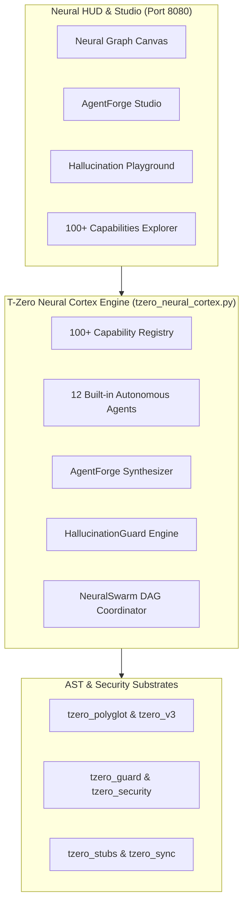

# 🧠 T-Zero Neural Cortex & AgentOS Architecture Specification
*Version: 9.0.0-CORTEX | Lead Architect: Toprak Ahmet Aydoğmuş (Siber Akademi)*
*Status: Approved | Cost Rating: 100% Free / Zero API Cost Guarantee*

---

## 1. Executive Vision & Objectives
T-Zero Neural Cortex transforms T-Zero from a static AST context pruner into a comprehensive, self-contained, offline-first **Neural AI Agent Operating System (AgentOS)**. It provides:
1. **100+ Modular AI Capabilities** covering security, context reduction, hallucination elimination, swarm coordination, and autonomous repair.
2. **12 Built-in Specialized Autonomous Subagents** operating as a collaborative neural swarm.
3. **`AgentForge` Subagent Synthesizer**: Generates dynamic task-specific subagent manifests (`agent.json`, `SKILL.md`) with minimal Tier-2 context boundaries.
4. **`HallucinationGuard` Real-Time Validator**: Pre-flight verification of imports, class methods, and call signatures against local AST tables with zero external API calls.
5. **Neural HUD Visual Web Studio**: 60 FPS Canvas-driven interactive neural graph visualizing nodes (agents, files, AST symbols) and glowing synaptic token streams.

---

## 2. System Architecture & Topology

---

## 3. The 100+ Capability Matrix Overview
The capabilities are categorized into 5 distinct tiers (20 capabilities per tier):
- **Tier I: Zero-Leak Security & Guardrails (01-20)**: Shannon entropy anomaly, 50+ secret rules, prompt injection shield, PII scrubbing, git pre-commit/pre-push hooks, offline cryptographic verification.
- **Tier II: AST Context & Token Hyper-Compression (21-40)**: Multi-tier pruning (T1-T4), typed stubbing (`.pyi`), dynamic knapsack context packer, AST body stripping, semantic diffing, symbol call chaining.
- **Tier III: Hallucination Annihilator & Pre-Flight Validation (41-60)**: Phantom import detector, method existence verification, argument count & keyword guard, type signature match, runtime mock execution sandbox.
- **Tier IV: Autonomous Swarm & Subagent Coordination (61-80)**: Dynamic DAG scheduler, blast-radius file lock (conflict-free parallel execution), agent consensus BFT voting, self-healing traceback loop.
- **Tier V: Polyglot Transpilation & Autonomous Evolution (81-100+)**: Python-to-TypeScript interface sync, dead-code elimination, code smell static auditor, automatic documentation generator, CI release gatekeeper.

---

## 4. 12 Built-in Specialized Subagent Fleet
1. `SecuritySentinelAgent`: Scans workspace for high-entropy secrets and injection vulnerabilities.
2. `ASTArchitectAgent`: Enforces architectural boundaries and inward-only dependencies.
3. `DeadCodePurgerAgent`: Identifies unused functions, classes, and orphaned symbols.
4. `TestSynthesizerAgent`: Generates missing unit tests based on function AST signatures.
5. `PolyglotTranspilerAgent`: Synchronizes type definitions across Python, TypeScript, Rust, and Go.
6. `BugHunterAgent`: Pinpoints root cause AST nodes from error tracebacks.
7. `PerformanceProfilerAgent`: Flags nested loops ($O(N^2)$), heavy imports, and memory leaks.
8. `DocstringGeneratorAgent`: Infers and generates standardized docstrings from AST nodes.
9. `DependencyAuditorAgent`: Audits external packages for supply-chain vulnerabilities.
10. `RefactorModernizerAgent`: Upgrades legacy language constructs to modern idiomatic forms.
11. `HallucinationValidatorAgent`: Evaluates candidate AI-generated code against local AST symbols.
12. `DevOpsReleaseAgent`: Automates release pipelines, version bumping, and packaging.
