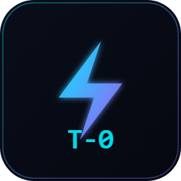

# T-Zero Context Architect & MCP (VS Code & Cursor Extension)

<p align="center">
  <br>
  <b>Enterprise-Grade Codebase Context Builder, AST Signatures Analyzer, & Token Reducer</b><br>
  <i>Cut LLM context window costs by up to 95% while keeping 100% of structural architectural clarity.</i>
</p>

<p align="center">
  <a href="https://github.com/toprakahmetaydogmus/TZeroAlgorithm"></a>
  <a href="https://www.npmjs.com/package/tzero-mcp"></a>
  <a href="https://github.com/toprakahmetaydogmus/TZeroAlgorithm/blob/main/LICENSE"></a>
</p>

---

## ⚡ Features

- **🚀 1-Click MCP Initialize:** Automatically configures Cursor (`.cursor/mcp.json`), Claude Desktop, Windsurf, and VS Code Copilot with zero manual setup.
- **✂️ Focus-Aware AST Pruner:** Compress large Python, TypeScript, Rust, Go, and C++ files down to minimal interface signatures before passing to AI.
- **🛡️ 100% Zero-Leak Security Audit:** Local static scan ensuring no secrets, credentials, or private keys enter the LLM context stream.
- **📊 Status Bar ROI Meter:** Displays real-time session token reduction and estimated cost savings.

## 📦 Instant Setup

Run directly with zero installation via `npx` or install globally:
```bash
# Instant MCP Execution:
npx -y tzero-mcp@latest

# Or install CLI via npm / pip:
npm install -g tzero-mcp
# or
pip install --upgrade tzero-mcp
```

## 🛠 Commands

Open the Command Palette (`Ctrl+Shift+P` / `Cmd+Shift+P`):
- `T-Zero: Initialize MCP in Workspace`: 1-Click install MCP server into Cursor & VS Code.
- `T-Zero: Compress Current File`: Compresses active file to AST signatures (-85% tokens).
- `T-Zero: Show AST Context Tree`: Generates compact workspace architecture skeleton.
- `T-Zero: Run 100% Zero-Leak Security & AST Audit`: Scans for code smells and leaked credentials.
- `T-Zero: Launch Local Developer Dashboard`: Opens interactive UI on `localhost:8421`.

---

**Developer:** Toprak Ahmet Aydoğmuş ([Siber Akademi](https://github.com/toprakahmetaydogmus/TZeroAlgorithm))  
**Repository:** [https://github.com/toprakahmetaydogmus/TZeroAlgorithm](https://github.com/toprakahmetaydogmus/TZeroAlgorithm)  
**License:** MIT
