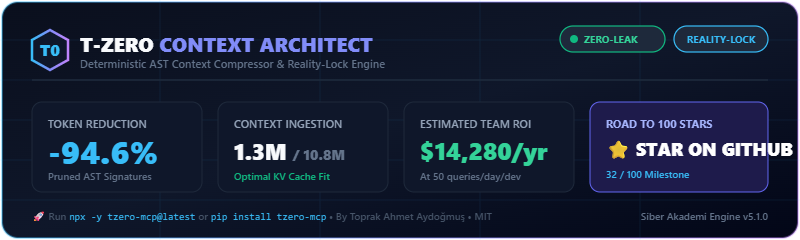
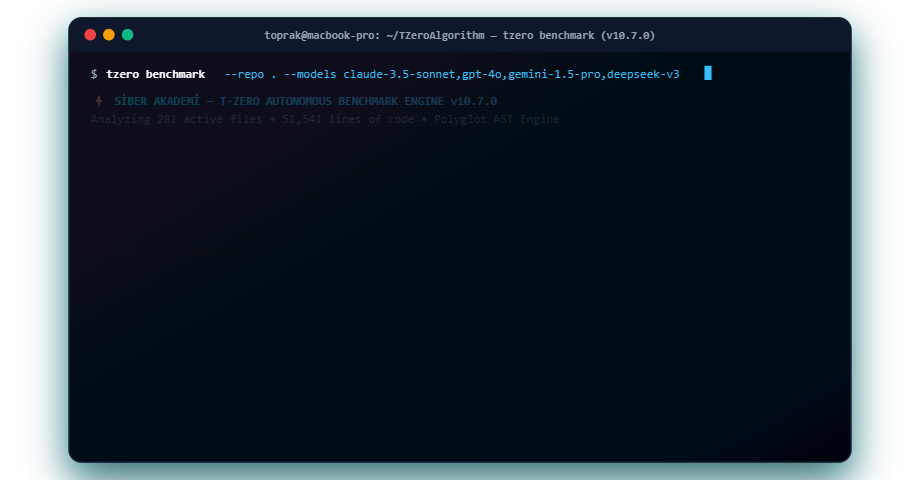

# T-Zero Context Architect & MCP (VS Code & Cursor Extension)

<p align="center">
  <a href="https://github.com/toprakahmetaydogmus/TZeroAlgorithm">
    <br>
  </a>
  <b>Enterprise-Grade Codebase Context Builder, AST Signatures Analyzer &amp; Token Reducer</b><br>
  <i>Cut LLM context window costs by up to 95% while keeping 100% of structural architectural clarity.</i>
</p>

<p align="center">
  <a href="https://marketplace.visualstudio.com/items?itemName=siber-akademi.tzero-vscode"></a>
  <a href="https://open-vsx.org/extension/siber-akademi/tzero-vscode"></a>
  <a href="https://github.com/toprakahmetaydogmus/TZeroAlgorithm"></a>
  <a href="https://www.npmjs.com/package/tzero-mcp"></a>
  <a href="https://github.com/toprakahmetaydogmus/TZeroAlgorithm/blob/main/LICENSE"></a>
</p>

> 🚀 **Over 25,000+ total downloads** across PyPI, npm, Open VSX, and VS Code Marketplace! 100% free, offline, local-first AST context compression for AI coding assistants.

<p align="center">
  <a href="https://github.com/toprakahmetaydogmus/TZeroAlgorithm">
    
  </a>
</p>

---

## Features

- **🚀 1-Click MCP Initialize:** Automatically configures Cursor (`.cursor/mcp.json`), Claude Desktop, Windsurf, and VS Code Copilot with zero manual setup.
- **✂️ Focus-Aware AST Pruner:** Compress large Python, TypeScript, Rust, Go, and C++ files down to minimal interface signatures before passing to AI.
- **🛡️ 100% Zero-Leak Security Audit:** Local static scan ensuring no secrets, credentials, or private keys enter the LLM context stream.
- **📊 Status Bar ROI Meter:** Displays real-time session token reduction and estimated cost savings.
- **🧠 Reality-Lock Grounding:** Verifies AST imports and function signatures to eliminate AI code hallucinations before writing code.

---

## Terminal Benchmark Preview

<p align="center">
  
</p>

---

## Instant Setup

Run directly with zero installation via `npx` or install globally:

```bash
# Instant MCP Execution:
npx -y tzero-mcp@latest

# Or install CLI via npm / pip:
npm install -g tzero-mcp
# or
pip install --upgrade tzero-mcp
```

---

## Commands

Open the Command Palette (`Ctrl+Shift+P` / `Cmd+Shift+P`):
- `T-Zero: Initialize MCP in Workspace`: 1-Click install MCP server into Cursor & VS Code.
- `T-Zero: Compress Current File`: Compresses active file to AST signatures (-85% tokens).
- `T-Zero: Show AST Context Tree`: Generates compact workspace architecture skeleton.
- `T-Zero: Run 100% Zero-Leak Security & AST Audit`: Scans for code smells and leaked credentials.
- `T-Zero: Launch Local Developer Dashboard`: Opens interactive UI on `localhost:8421`.
- `T-Zero: Refresh Live AST Telemetry`: Scans the workspace (`--scan --format json`) and updates the Status Bar & Activity Bar Sidebar Cockpit.
- `T-Zero: Generate AST Architectural Passport (--explain)`: Produces structured AST symbol passports for Python & polyglot files.
- `T-Zero: Analyze Code Health & Technical Debt (--debt)`, `T-Zero: Optimize Token Budget (--budget)`, `T-Zero: Audit Public API Contracts (--contracts)`, `T-Zero: Golden AST Baseline (--golden)`, `T-Zero: AST Mutation Test (--mutate)`, `T-Zero: Polyglot Type Bridge (--bridge)`, and `T-Zero: Semantic 3-Way Merge Healer (--merge-heal)`.

---

**Publisher:** Siber Akademi ([Toprak Ahmet Aydoğmuş](https://linkedin.com/in/toprak-ahmet-aydo%C4%9Fmu%C5%9F-60462534b/))  
**GitHub Repository:** [https://github.com/toprakahmetaydogmus/TZeroAlgorithm](https://github.com/toprakahmetaydogmus/TZeroAlgorithm)  
**License:** [AGPL-3.0-only](https://github.com/toprakahmetaydogmus/TZeroAlgorithm/blob/main/LICENSE)
